# VEXORA — System Architecture & Forensic Intelligence Pipeline

## 1. Executive Architecture Overview

**VEXORA** is a multi-modal, explainable digital document forensics platform engineered to detect document manipulation, visual overwrites, typographic anomalies, and contextual discrepancies across multi-document fraud schemes.

```mermaid
flowchart TD
    subgraph Ingestion ["Stage 1: Ingestion & Chain of Custody"]
        A[Incoming Documents: PDF / PNG / JPG] --> B[Binary Magic Byte & File Header Validation]
        B --> C[SHA-256 Cryptographic Hash Generation]
        C --> D[(SQLite Evidence Vault & Audit Log)]
    end

    subgraph Extraction ["Stage 2: Multimodal Extraction Engine"]
        A --> E[PyMuPDF Vector Parser]
        E --> E1[Text Blocks, Spans, Bounding Boxes]
        E --> E2[Font Families, Weights, Sizes]
        E --> E3[Vector Path Drawings & Fill Colors]
        A --> F[Raster & Scan Engine]
        F --> F1[PyMuPDF High-Res Pixmap 150 DPI]
        F --> F2[Pytesseract Word Data & Real Confidence]
    end

    subgraph ForensicEngine ["Stage 3: Hybrid Forensic Analysis Engine"]
        subgraph PDF_Forensics ["PDF Vector Forensics"]
            E3 --> G1[PDF-R101: White Vector Rectangle Masking]
            A --> G2[PDF-R102: Multiple %%EOF Incremental Saves]
            E --> G3[PDF-R103: Producer / Issuer Mismatch]
            E --> G4[PDF-R104: Superimposed Images Over Text]
            E --> G5[PDF-R105: Embedded Image DPI Variance]
        end

        subgraph Image_Forensics ["Raster Image Forensics (Heuristics)"]
            F1 --> H1[IMG-R201: Error Level Analysis ELA]
            F1 --> H2[IMG-R202: 8x8 Grid Noise Inconsistency]
            F1 --> H3[IMG-R203: Signature Proximity & Density Check]
        end

        subgraph Rule_Baseline ["Deterministic Rule Engine"]
            E1 & E2 --> I1[RULE-VIS-001: Typographic Font Kerning Anomaly]
            E1 --> I2[RULE-VIS-002: Text Overlap & Bounding Box Collision]
            E1 --> I3[RULE-VIS-003: Margin & Boundary Overflow]
            E1 --> I4[RULE-CTX-001: Chronological Date Flow Inversion]
            E1 --> I5[RULE-CTX-003: Contextual Arithmetic Discrepancy]
            E1 --> I6[RULE-CTX-005: Line Items vs Total Verification]
        end
    end

    subgraph LLM_Layer ["Stage 4: Google GenAI Intelligence Layer (gemini-2.5-flash)"]
        E1 & I5 & I6 --> J1[Structured Field Extraction JSON]
        J1 --> J2[Contextual Mathematical Verification]
        ForensicEngine --> J3[Traceable Finding Explanations with Exact Quotes]
        J3 --> J4[Dossier Executive Summary Synthesis]
        J4 --> J5["Mandatory Tag: 'AI-assessed, needs review'"]
    end

    subgraph CrossDoc ["Stage 5: Cross-Document Discrepancy Matrix & Provenance"]
        E1 & J1 --> K1[Semantic Label & ID Alignment]
        K1 --> K2[Cross-Document Contradiction Detector]
        K2 --> K3[Evidence Provenance Graph: Nodes & Edges]
    end

    subgraph Visualization ["Stage 6: Visual Evidence Rendering"]
        ForensicEngine & LLM_Layer --> L1[PyMuPDF Pixmap Highlighting]
        L1 --> L2[Crisp Red Bounding Boxes Drawn on Actual Pages]
        L2 --> L3[Interactive Real Document UI Viewport]
    end

    subgraph Reporting ["Stage 7: Investigation Dossier & Audit Log"]
        D & ForensicEngine & LLM_Layer & CrossDoc & L2 --> M[PDF Dossier Generator: PS Sections 7.1 to 7.6]
        M --> N[Embedded Vector Page Evidence Images]
        M --> O[Cryptographic Dossier Hash Verification]
    end
```

---

## 2. Component Pipeline Deep Dive

### 2.1 Ingestion & Evidentiary Integrity
- **Magic Byte Validation**: `backend/uploader.py` validates file headers (`%PDF-`, `\x89PNG\r\n\x1a\n`, `\xff\xd8\xff`) to guarantee file authenticity.
- **Cryptographic Chain of Custody**: Every ingested artifact is assigned a permanent SHA-256 fingerprint stored in SQLite `audit_log` before any processing occurs.
- **Demo Isolation**: Seed reference files are strictly segregated from active case files.

### 2.2 Vector & Raster Extraction Engine
- **PyMuPDF (`fitz`) Text Spans**: Extracts exact character bounding boxes `(x0, y0, x1, y1)`, font names, font sizes, line heights, and vector drawings (`page.get_drawings()`).
- **Word-Level Confidence**: Scanned documents utilize `pytesseract.image_to_data` to obtain word-level confidence ratings (0.0 to 1.0). If Tesseract is not installed on the host system, the system honestly reports `ocr_available: false` without generating fake visual artifact text.

### 2.3 Real PDF Forensics Engine (`backend/pdf_forensics.py`)
- **PDF-R101 (White Vector Rectangle Masking)**: Detects opaque white vector paths (`fill == (1,1,1)`) positioned over text spans—the classic digital alteration method to redact or obscure underlying figures.
- **PDF-R102 (Multiple `%%EOF` Incremental Saves)**: Scans the raw binary for multiple End-Of-File markers, revealing post-generation alterations or modifications in hex editors.
- **PDF-R103 (Producer / Issuer Mismatch)**: Verifies document metadata against expected enterprise issuers (e.g. government forms generated via Canva or Word).
- **PDF-R104 (Superimposed Graphics Over Text)**: Identifies image XObjects layered over rendered text blocks.
- **PDF-R105 (Image Resolution Inconsistencies)**: Computes horizontal and vertical DPI across embedded images; significant resolution discrepancies within a single page indicate pasted artifacts.

### 2.4 Real Image Forensics Engine (`backend/image_forensics.py`)
- **IMG-R201 (Error Level Analysis - ELA)**: Re-compresses raster images at a fixed 90% quality level and computes absolute pixel difference matrices to expose spliced or modified regions with differing compression signatures (explicitly labeled heuristic).
- **IMG-R202 (Noise Variance Inconsistency)**: Computes local Laplacian variance across an 8x8 grid to detect patches with anomalous high/low noise floors (heuristic).
- **IMG-R203 (Signature Presence & Proximity Check)**: Searches for "Signature", "Signatory", or "Authorized" labels and verifies whether ink stroke pixel density exists within the expected spatial neighborhood (heuristic).

### 2.5 Google GenAI LLM Layer (`backend/llm_layer.py`)
- **API Model**: Powered by Google Gemini (`gemini-2.5-flash`) via the modern `google-genai` SDK.
- **Verbatim Quoting**: Prompts enforce that the model quotes the verbatim document text supporting each claim, preventing hallucinations.
- **Contextual Arithmetic Verification**: Performs cross-field calculation (line items sum vs stated total, tax rate validation).
- **Mandatory Attestation**: All LLM-generated explanations and summaries are tagged with:
  > **[AI-assessed, needs review]**
- **Deterministic Offline Fallback**: If `GEMINI_API_KEY` is not present, the system seamlessly falls back to an offline rule-driven engine that extracts structured fields and quotes verbatim text with 100% test pass rate.

### 2.6 Visual Evidence Rendering (`backend/visualizer.py`)
- **PyMuPDF Pixmap Highlighting**: Calls `page.get_pixmap(dpi=150)` and overlays crisp red bounding boxes `[x1, y1, x2, y2]` with rule identifiers onto the real page.
- **Real Interactive Document Viewer**: Replaced the previous simulated paper viewer in `frontend/index.html` with high-resolution page rendering, Prev/Next page navigation, zoom controls, and a bounding-box overlay toggle.

### 2.7 Cross-Document Discrepancy & Provenance Graph
- **Semantic Entity Matching**: Correlates fields across multiple documents using semantic labels and reference identifiers (e.g., matching Invoice #0944 Total against Bank Statement Debit with matching reference).
- **Provenance Graph**: Generates nodes (Documents, Entities, Findings) and directed edges (REFERENCES, CONTRADICTS, PROVES) exposed via `/api/documents/<doc_id>/provenance`.

### 2.8 Investigation Dossier Generation (`backend/reporter.py`)
- **Sections 7.1 to 7.6**: Produces vector-rendered PDF dossiers covering Case Metadata (7.1), Evidentiary Inventory (7.2), Visual Observations (7.3), Cross-Document Discrepancy Matrix (7.4), Provenance Graph (7.5), and Examiner Attestation with SHA-256 verification hash (7.6).
- **Embedded Page Proofs**: Uses `fitz.insert_image` to embed rendered evidence pages with red highlighted anomaly bounding boxes directly into the PDF report.
