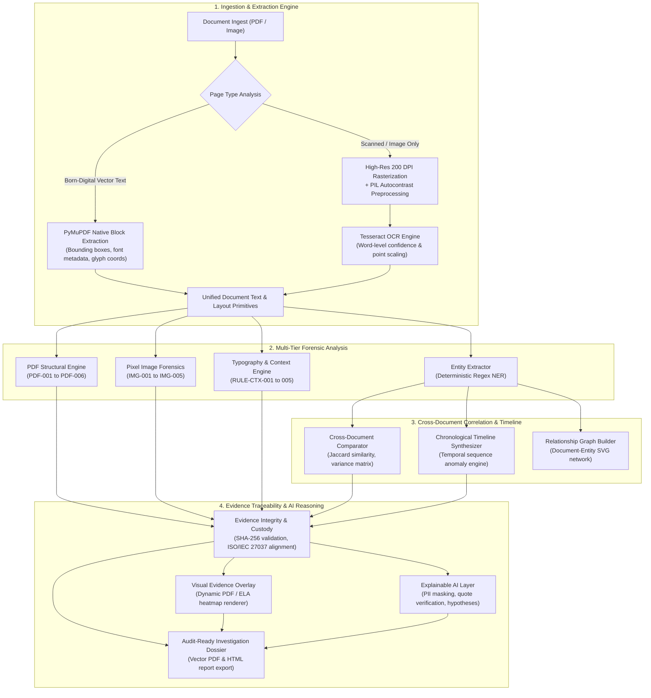

# VEXORA — Technical Capabilities & Forensic Rules Reference

This document provides a comprehensive technical inventory of the forensic detection rules, mathematical heuristics, extraction pipelines, and security controls implemented in **VEXORA** (*AI-Powered Document Forensics and Contextual Intelligence System*).

---

## 1. System Architecture Overview

---

## 2. Forensic Rules Catalog

VEXORA evaluates digital evidence through deterministic, reproducible rules. Every finding is assigned an objective **Evidence Class** (`Observation`, `Inconsistency`, or `Potential Manipulation`) and an evidence-backed **Severity** (`Low`, `Medium`, `High`, `Critical`).

### 2.1 PDF Structural Forensic Rules

| Rule ID | Name | Evidence Class | Severity | Detection Mechanism & Mathematical Logic |
|---|---|---|---|---|
| `PDF-001` | Font Subset Anomaly | `Observation` | Low | Detects non-embedded fonts or font families with less than 10 glyphs where standard document typography uses full subsets. |
| `PDF-002` | Incremental Update / Modification | `Potential Manipulation` | High | Parses the PDF xref table and `%%EOF` trailer markers. Detects appended byte streams and divergent `/Prev` pointers indicating post-creation revision. |
| `PDF-003` | Editing Software Signatures | `Inconsistency` | Medium | Inspects `/Producer`, `/Creator`, and XMP metadata dictionaries for desktop graphic editing signatures (`Adobe Photoshop`, `GIMP`, `Canva`, `Illustrator`) in documents claiming to be system-generated. |
| `PDF-004` | Visual Vector Overwrite on Scans | `Potential Manipulation` | High | Identifies digital vector text primitives overprinted directly on top of full-page scanned background raster bitmaps. |
| `PDF-005` | Page Geometry & Orientation Inconsistency | `Inconsistency` | Medium | Checks multi-page documents for divergent bounding media boxes (`/MediaBox`, `/CropBox`) and rotation angles indicating spliced pages from different sources. |
| `PDF-006` | Suspicious PDF Dictionary Objects | `Potential Manipulation` | Critical | Scans document catalog and xref pointers for `/JavaScript`, `/Launch`, or embedded executable file streams. |

---

### 2.2 Pixel-Level Image Forensic Rules

Image forensics are strictly gated to raster uploads (`.png`, `.jpg`, `.jpeg`, `.tiff`) and embedded raster objects in PDFs, preventing false alarms on clean born-digital vector files.

| Rule ID | Name | Evidence Class | Severity | Detection Mechanism & Mathematical Logic |
|---|---|---|---|---|
| `IMG-001` | Error Level Analysis (ELA) | `Observation` | Medium | Recompresses the image at 90% JPEG quality, computes pixel-by-pixel Euclidean difference in RGB space, and amplifies high-frequency compression inconsistencies. Automatically saves visual difference heatmaps in `uploads/evidence/`. |
| `IMG-002` | Laplacian Sharpness & Blur Discontinuity | `Observation` | Medium | Divides the image into a $64 \times 64$ grid, computes the local variance of the Laplacian $\sigma^2(\nabla^2 I)$, and flags localized high-frequency sharpness patches amidst uniform background noise. |
| `IMG-003` | ORB Keypoint Copy-Move Forgery | `Potential Manipulation` | Medium | Extracts oriented FAST and rotated BRIEF (ORB) keypoint descriptors, filters matches by Hamming distance ($d < 45.0$), excludes collocated text lines, and rejects 1D collinear patterns to detect cloned stamps or signatures. |
| `IMG-004` | Signature Region Verification | `Observation` | Low | Segments document signature and stamp bounding boxes, evaluates stroke aspect ratio, connected component density, and perimeter contours. |
| `IMG-005` | EXIF Camera & Timestamp Divergence | `Observation` | Low | Inspects raw EXIF tags for camera make/model signatures, GPS geometry, and checks for chronological divergence between capture timestamp (`DateTimeOriginal`) and modification timestamp (`DateTime`). |

---

### 2.3 Contextual & Chronological Rules

| Rule ID | Name | Evidence Class | Severity | Detection Mechanism & Mathematical Logic |
|---|---|---|---|---|
| `RULE-CTX-001` | Font Size / Kerning Anomaly | `Observation` | Medium | Measures glyph point sizes and baseline kerning distributions across neighboring characters, flagging single-word typographic shifts. |
| `RULE-CTX-002` | Round Amount Suspicion | `Observation` | Low | Detects round monetary totals ($> \$10,000$ ending in `.00`) in transactional documents that typically include statutory taxes and fractional adjustments. |
| `RULE-CTX-003` | Contradictory Chronology | `Inconsistency` | High | Identifies internally contradictory transaction dates (e.g. invoice payment due date preceding invoice issuance date, or transaction dates set in the distant future). |
| `RULE-CTX-004` | Missing Mandatory Statutory Fields | `Observation` | Medium | Inspects corporate invoices and tax returns for absent statutory identifiers (Tax Identification Number, VAT ID, Registered Office Address). |
| `RULE-CTX-005` | Duplicate Reference Collision | `Inconsistency` | High | Detects duplicate invoice numbers or reference codes across distinct counterparties or differing monetary values. |
| `RULE-TIME-001` | Pre-Dated Commercial Invoice | `Potential Manipulation` | Critical | Chronological business sequence correlation: flags invoices issued prior to the authorization date of the corresponding Purchase Order. |
| `RULE-TIME-002` | Pre-Invoice Bank Settlement | `Inconsistency` | High | Chronological clearing correlation: flags bank deposits or account settlements credited before the associated commercial invoice was generated. |

---

## 3. Evidence Traceability & Chain of Custody (ISO/IEC 27037 Principles)

1. **Cryptographic Ingestion Hash:**
   Every document is hashed with SHA-256 upon reception. The hash is immutably linked to the document record.
2. **On-Demand Integrity Verification:**
   The `GET /api/documents/<id>/integrity` endpoint re-hashes the stored file from disk in real-time, comparing it against the ingest hash to detect file tampering or storage bit-rot.
3. **Chain of Custody Timeline:**
   The `GET /api/documents/<id>/custody` endpoint provides an ordered audit trail of every forensic action (Uploaded, Extracted, Analyzed, Compared, Integrity Checked, Reported) with UTC timestamps, user identity, and event details.
4. **Spatial Bounding Box Traceability:**
   Findings preserve physical document coordinates `[x0, y0, x1, y1]` allowing the dynamic visual inspector and dossier reports to render exact highlight overlays. Non-spatial findings explicitly display a clear *"Contextual / Non-Visual Forensic Finding"* advisory.

---

## 4. Explainable AI & Privacy Safeguards

1. **Anti-Hallucination Quote Grounding:**
   When the optional LLM reasoning layer generates structured extractions, every extracted field must provide a verbatim `source_quote`. VEXORA verifies that the quote exists as an exact substring in the extracted document text; ungrounded assertions are automatically discarded.
2. **Automated PII Redaction:**
   Before any text snippet is transmitted to external AI reasoning APIs, VEXORA redacts:
   - International Bank Account Numbers (IBAN) $\to$ `[REDACTED_IBAN]`
   - Payment Card Numbers (Visa, Mastercard, Amex, Discover) $\to$ `[REDACTED_CARD]`
   - National Identification Numbers (Social Security, Aadhaar) $\to$ `[REDACTED_ID]`
   - Email Addresses & Phone Numbers $\to$ `[REDACTED_EMAIL]`, `[REDACTED_PHONE]`
3. **Plausible Innocent Hypotheses & Human Review:**
   AI-generated explanations must provide plausible alternative explanations (e.g., scan compression artifacts, legitimate software conversions) and concrete next verification steps. Every AI explanation carries the mandatory disclaimer:
   > *"AI-assessed, requires human review. Findings are automated forensic observations subject to human investigator confirmation."*

---

## 5. Security & Defense-in-Depth Architecture

- **Path Traversal Protection:** All file paths are strictly resolved against `UPLOAD_FOLDER` and checked for containment (`resolved_dest.startswith(resolved_target)`). Filenames with null bytes (`\0`) or directory traversal sequences (`..`) are rejected with HTTP 400.
- **Role Elevation Prevention:** User registration blocks self-assigned administrative roles (`admin`, `superuser`, `administrator`).
- **Timing-Safe Password Verification:** Employs PBKDF2 with SHA-256 password hashing.
- **Session Cookie Hardening:** `HttpOnly = True`, `SameSite = 'Lax'`, and configurable `Secure` flags.
- **Multi-Thread Process Mutex:** Thread-safe SQLite transactions protected by `@_synchronized_model` mutex locks, preventing concurrent ID collisions.
