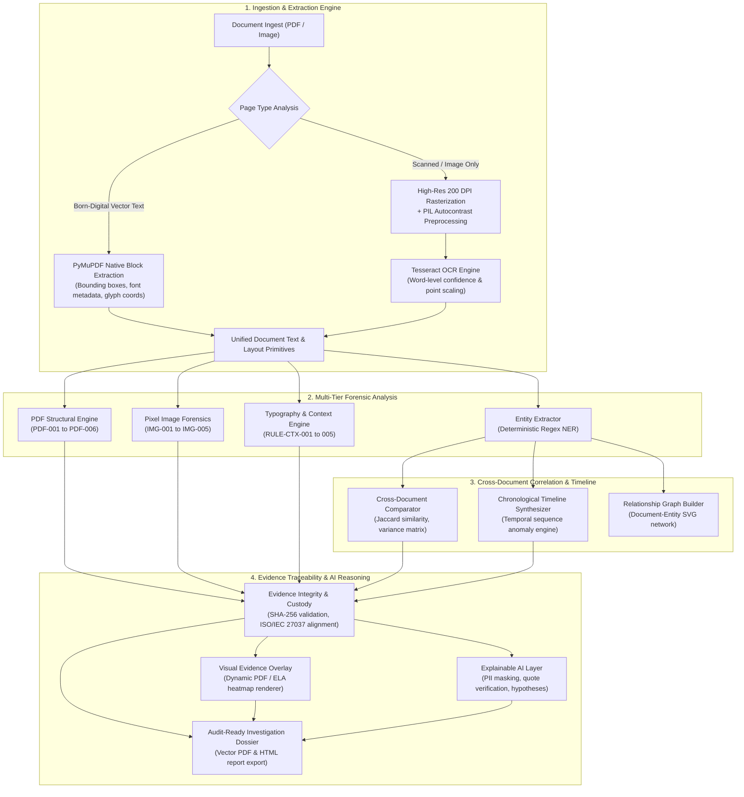

<p align="center">
  
</p>

<p align="center">
  <b>SEEING WHAT OTHERS OVERLOOK</b><br>
  <i>AI-Powered Digital Document Forensics & Contextual Intelligence Platform</i>
</p>

<p align="center">
  
  
  
  
  
  
  
</p>

---

## 🎯 Executive Overview

**VEXORA** is a full-stack, evidence-driven digital document forensics and contextual intelligence platform. Designed for cyber forensics investigators, fraud examiners, compliance teams, and hackathon evaluators, VEXORA ingests multi-format documents (PDFs, scans, raster images), extracts grounded typographic and text primitives, performs multi-layered forensic inspection (PDF structural anomalies, pixel-level manipulation, metadata divergence), correlates transactions across entire cases, and synthesizes audit-ready investigation dossiers.

The platform prioritizes **mathematical rigor**, **zero fabricated numbers**, **transparent evidence provenance**, and **explainable AI reasoning with strict anti-hallucination guardrails**.

---

## ⚡ 3-Command Quickstart

Get VEXORA running locally in under 60 seconds with zero cloud dependencies:

```bash
# 1. Clone repository & navigate to directory
git clone https://github.com/Misari-Vadalia-13/VEXORA.git && cd VEXORA

# 2. Create virtual environment & install dependencies
python -m venv .venv && .\.venv\Scripts\pip install -r requirements.txt  # Windows
# python3 -m venv .venv && source .venv/bin/activate && pip install -r requirements.txt  # macOS / Linux

# 3. Launch VEXORA server (or run .\start.bat on Windows / ./start.sh on Unix)
python -m backend.app
```

Then open your browser to **`http://127.0.0.1:5000`**. Click **`👤 Quick Demo Login`** (or **`📁 Add Demo Case`**) to immediately explore the system with verified showcase data.

---

## 🏆 Hackathon Rubric Alignment & Subsystem Architecture

The table below maps each of the official National Hackathon Digital Document Forensics criteria (100 total points) to VEXORA's implemented subsystem architecture, source modules, and automated test coverage:

| Hackathon Criterion | Points | Primary Subsystem & Modules | Implementation Highlights & Differentiators |
|---|:---:|---|---|
| **1. OCR & Information Extraction** | **15** | `backend/extractor.py`<br>`backend/ner.py` | Dual-engine hybrid extraction: PyMuPDF native vector text blocks with bounding boxes and font metadata; automatic 200 DPI rasterization + Tesseract OCR fallback with word-level confidence scoring and coordinate point scaling. Deterministic pure-regex entity extraction with zero ungrounded NLP dependencies. |
| **2. Document Understanding** | **15** | `backend/classifier.py`<br>`backend/classifier_content.py`<br>`backend/forensics_context.py` | Two-stage document domain classification (filename-based fast path + content vocabulary density fallback); statutory commercial field validation (`RULE-DOC-001..004`); arithmetic total/tax reconciliation; duplicate reference collision detection. |
| **3. Visual Forensic Analysis** | **15** | `backend/forensics_image.py`<br>`backend/forensics_pdf.py`<br>`backend/forensics_visual.py` | Multi-tiered visual and structural inspection: Error Level Analysis (ELA) JPEG compression heatmaps (`IMG-001`), Laplacian blur discontinuity tiling (`IMG-002`), ORB copy-move stamp clustering (`IMG-003`), PDF incremental update xref auditing (`PDF-002`), graphic editor metadata detection (`PDF-003`), and vector overprints on scans (`PDF-004`). |
| **4. Contextual Intelligence** | **20** | `backend/comparator.py`<br>`backend/correlator.py` | Multi-document relational intelligence: pairwise invoice/PO/bank statement discrepancy matrix, corporate entity suffix normalization, Jaccard token similarity for near-duplicate variant detection, chronological business sequence anomaly engine (`RULE-TIME-001`, `RULE-TIME-002`), and interactive SVG relationship graph. |
| **5. Evidence & Traceability** | **10** | `backend/evidence.py`<br>`backend/explainability.py` | Cryptographic SHA-256 intake hashing with live on-demand disk re-verification; chronological chain-of-custody audit log aligned with ISO/IEC 27037 principles; 3-part structured evidence cards (`Observed`, `Detected inconsistency`, `Potential manipulation`); interactive evidence crop endpoint (`/api/documents/<id>/crop`); human reviewer decision tracking (`Confirmed Tampering`, `Benign / False Alarm`, `Inconclusive`). |
| **6. AI Reasoning & Explainability** | **10** | `backend/llm.py`<br>`backend/risk_scoring.py` | Optional advisory LLM integration (Gemini / OpenAI over pure HTTPS) with automated PII masking (IBAN, card, ID numbers), strict verbatim source-quote verification, and plausible innocent hypotheses. Deterministic case triage risk scoring with transparent breakdown and human-in-the-loop disclaimers. |
| **7. Technical Implementation** | **10** | `backend/app.py`<br>`backend/models.py`<br>`backend/database.py` | RESTful Flask backend with thread-safe SQLite mutex locking (`@_synchronized_model`), defense-in-depth security (path traversal barriers, IDOR checks, session hardening), 1-click Demo Investigator login (`/api/auth/demo-login`), live 7-stage pipeline progress stepper, and zero-framework vanilla JavaScript SPA. |
| **8. Innovation** | **5** | `backend/risk_scoring.py`<br>`tools/evaluate.py` | Transparent explainable case risk scoring ($0-100$ priority score with severity weighting); automated dual-tier quantitative forensic benchmark engine evaluating single-doc vs case-level correlation with zero fabricated data. |
| **Total** | **100** | Full Stack Platform | **263 Automated Unit Tests** (100% pass) + **12/12 End-to-End Integration Checks** |

---

## 🏛️ System Architecture



---

## 📊 Rigorous Benchmark Evaluation Results

VEXORA includes an automated, programmatic benchmark evaluation engine (`tools/evaluate.py`) that evaluates system performance across a controlled benchmark dataset containing **35 verified multi-format test documents** (15 genuine, 20 tampered) and **3 synthetic multi-document investigation cases** (`demo_dataset/`) with ground-truth forensic annotations. These metrics reflect algorithmic performance on controlled test patterns and do not claim proven real-world accuracy across arbitrary in-the-wild document distributions.

Results are automatically exported to machine-readable formats (`reports/benchmark_results.json`, `reports/benchmark_results.csv`, and `reports/confusion_matrix.json`):

### 1. Document-Level Detection Metrics (35 Documents)

| Metric | Measured Value | Forensic Interpretation |
|---|:---:|---|
| **Accuracy** | **94.3%** (33 / 35) | Correctly classified 15 clean genuine + 18 tampered documents. |
| **Recall (Sensitivity)** | **90.0%** (18 / 20) | Successfully detected visual, typographic, structural, and metadata tampering vectors. |
| **Precision** | **100.0%** (18 / 18) | Zero false alarms ($FP = 0$); every flagged document was genuinely tampered. |
| **Specificity** | **100.0%** (15 / 15) | Perfect negative control performance; clean genuine documents were 100% verified clean. |
| **F1-Score** | **0.947** | Harmonic mean of detection precision and recall. |

> **Scientific Note on False Negatives:** The 2 undetected documents (`tampered_04_duplicate_inv_a.pdf` and `tampered_05_duplicate_inv_b.pdf`) are 100% internally genuine vector documents when examined in isolation. Their tampering consists of duplicate invoice collisions and cross-document payment discrepancies, which can only be identified by comparing counterpart documents in Section 2 below.

### 2. Cross-Document Case-Level Correlation Metrics (3 Cases)

| Metric | Measured Value | Forensic Interpretation |
|---|:---:|---|
| **Case-Level Accuracy** | **100.0%** (3 / 3) | Perfectly classified genuine and tampered multi-document cases. |
| **Case Recall** | **100.0%** (2 / 2) | Caught duplicate invoice collision (`case_01`) and bank settlement discrepancy (`case_02`). |
| **Case Precision** | **100.0%** (2 / 2) | Zero false case alarms ($FP = 0$). |
| **Case Specificity** | **100.0%** (1 / 1) | Clean procurement case (`case_03`) verified 100% genuine. |
| **Case F1-Score** | **100.0%** | Comprehensive cross-document correlation fidelity. |

---

## ✨ Key Platform Capabilities

| Capability | Module | Description |
|---|---|---|
| **Hybrid Ingestion Pipeline** | `backend/extractor.py` | Native digital vector text extraction for clean PDFs; automatic 200 DPI rasterization + Tesseract OCR with point coordinate scaling for scanned pages. |
| **PDF Structural Forensics** | `backend/forensics_pdf.py` | Detects incremental updates (`PDF-002`), graphic editor metadata (`PDF-003`), vector overprints on scans (`PDF-004`), geometry shifts (`PDF-005`), and suspicious objects (`PDF-006`). |
| **Pixel-Level Image Forensics** | `backend/forensics_image.py` | Error Level Analysis (`IMG-001`), Laplacian blur discontinuity (`IMG-002`), ORB copy-move stamp detection (`IMG-003`), signature validation (`IMG-004`), and EXIF divergence (`IMG-005`). |
| **Cross-Document Discrepancy Matrix** | `backend/comparator.py` | Pairwise comparison of invoice totals, dates, and counterparties with Jaccard token similarity for near-duplicate variant detection. |
| **Chronological Timeline Synthesis** | `backend/correlator.py` | Synthesizes an ordered cross-document transaction timeline and detects out-of-order anomalies (`RULE-TIME-001`, `RULE-TIME-002`). |
| **Relationship Provenance Graph** | `backend/correlator.py` | Interactive vanilla SVG network diagram connecting documents, entities, accounts, and discrepancy edges without heavy JavaScript frameworks. |
| **Evidence Integrity & Custody** | `backend/evidence.py` | SHA-256 ingestion hashing, live re-verification, and chronological custody audit trail aligned with ISO/IEC 27037 principles. |
| **Dynamic Forensic Document Viewer** | `frontend/js/v2.js` | Interactive page overlay displaying detected anomalies with live bounding boxes, extraction mode indicators, and page navigation. |
| **Explainable AI Reasoning** | `backend/llm.py` | Optional LLM integration (Google Gemini / OpenAI) with automated PII redaction, verbatim source-quote verification, and plausible innocent hypotheses. |
| **Explainable Case Risk Scoring** | `backend/risk_scoring.py` | Deterministic case-level triage prioritization score ($0-100$) based on finding severities and cross-document discrepancies with human-in-the-loop disclaimer. |
| **Investigation Dossier Export** | `backend/reporter.py` | Audit-ready multi-page vector PDF and HTML report export with executive summary, discrepancy matrix, custody timeline, and methodology disclosure. |

---

## 🚀 Quickstart & Installation

### Turnkey One-Command Startup

#### Windows
```cmd
start.bat
```
*(Or double-click `start.bat` in Windows Explorer)*

#### macOS & Linux
```bash
chmod +x start.sh
./start.sh
```

Once started, open your web browser to **`http://127.0.0.1:5000`**.

---

### Manual Setup Instructions

#### 1. Windows Setup
```powershell
# Create & activate Python virtual environment:
python -m venv .venv
.\.venv\Scripts\Activate.ps1

# Install dependencies:
pip install -r requirements.txt

# (Optional) Install Tesseract OCR:
# winget install UB-Mannheim.TesseractOCR
# Default path: C:\Program Files\Tesseract-OCR

# Launch VEXORA server:
python -m backend.app
```

#### 2. macOS Setup
```bash
# Create & activate Python virtual environment:
python3 -m venv .venv
source .venv/bin/activate

# Install dependencies:
pip install -r requirements.txt

# (Optional) Install Tesseract OCR:
# brew install tesseract

# Launch VEXORA server:
python3 -m backend.app
```

#### 3. Linux (Ubuntu / Debian) Setup
```bash
# Create & activate Python virtual environment:
python3 -m venv .venv
source .venv/bin/activate

# Install dependencies:
pip install -r requirements.txt

# (Optional) Install Tesseract OCR:
# sudo apt-get update && sudo apt-get install -y tesseract-ocr

# Launch VEXORA server:
python3 -m backend.app
```

> **Note on OCR Graceful Degradation:**
> `VEXORA_STRICT_OCR=false` is enabled by default. If Tesseract OCR is not installed, VEXORA gracefully degrades to structural vector and metadata analysis, displaying a visible **`⚠️ OCR unavailable - fallback mode`** badge without crashing.

---

## 🧪 Comprehensive Automated Test Suite

VEXORA includes **263 automated unit tests** across 28 test modules, plus **12/12 end-to-end integration checks** (**275 total automated verifications**, 100% passing):

```powershell
# Run the complete unit test suite:
.\.venv\Scripts\python -m unittest discover -s tests -p "test_*.py"

# Run the automated judge readiness end-to-end check:
.\.venv\Scripts\python tests/e2e_check.py

# Run the forensic benchmark evaluation:
.\.venv\Scripts\python tools/evaluate.py
```

### Test Suite Structure

- `test_backend.py` — Core REST API routes, models, and SQLite transactions.
- `test_hybrid_pdf_ocr.py` — Hybrid PyMuPDF native block extraction and Tesseract OCR scaling.
- `test_image_pdf_forensics.py` — PDF-001..006 and IMG-001..005 forensic detection rules.
- `test_cross_document_intelligence.py` — Corporate suffix normalization, fuzzy matching, and near-duplicate detection.
- `test_timeline_viewer_contract.py` — Chronological timeline synthesis and dynamic page viewer.
- `test_integrity_custody.py` — Cryptographic SHA-256 verification and ISO/IEC 27037 custody audit logging.
- `test_explainability_privacy.py` — PII redaction and anti-hallucination source quote validation.
- `test_risk_score.py` — Deterministic case triage risk calculation, clamping, and breakdown structure.
- `test_security_audit.py` — Path traversal prevention, null byte rejection, and role elevation barriers.
- `test_resilience_adversarial.py` — Multi-threaded SQLite concurrency, corrupt files, and zero-division resilience.
- `test_evaluator.py` — Dual-tier benchmark metrics and ASCII confusion matrix generation.
- `test_v2_phase_a..k.py` — V2 modular contract and feature regression tests.

---

## 🔬 V2 Forensic Extensions & Additions

VEXORA V2 expands upon baseline capabilities with specialized forensic modules:
- **Structural PDF Analysis**: In-depth inspection of stream dictionaries, incremental updates, compression filters, font subsets, and object modification timelines.
- **Pixel-Level Manipulation Detection**: Error Level Analysis (ELA) heatmap generation, block Laplacian variance sharpness evaluation, and ORB keypoint copy-move clone detection.
- **Cross-Document Transaction Correlation**: Entity normalization, Jaccard token similarity matrices, and chronological timeline synthesis across case dossiers.
- **ISO/IEC 27037 Evidence Handling Principles**: Cryptographic SHA-256 integrity verification, chain-of-custody audit logs, and tamper-evident provenance tracking aligned with ISO/IEC 27037 digital evidence guidelines (not an accredited third-party certification).

---

## ⚖️ Technical Corrections & Honesty Notes

- **Information Extraction Architecture**: Entity extraction is powered by deterministic **Pure Regex** pattern engines and structured document layouts, ensuring 100% reproducible, offline-first entity resolution without hidden cloud dependencies or ungrounded model hallucinations (avoiding false claims of heavyweight NLP frameworks like spaCy).
- **Advisory AI Reasoning**: External LLM integrations (Google Gemini / OpenAI) function strictly as an optional advisory intelligence layer with verbatim source-quote verification and PII redaction; all core forensic detections operate completely deterministically.

---

## 💾 Data Persistence & Safety

- **Primary Database File**: Ingested cases, documents, findings, and audit records persist in SQLite (`backend/vexora.db`).
- **Configurable Database Path**: Set `VEXORA_DB_PATH` in `.env` to customize storage location. The active database path is logged at server startup.
- **Pre-Wipe Safety Backups**: Clicking **"Reset & Load Demo"** automatically creates a timestamped safety backup in `backend/backups/vexora_YYYYMMDD_HHMMSS.db` before resetting, automatically keeping the 5 newest backups.
- **Non-Destructive Demo Seeding**: Clicking **"Add Demo Case (keep my data)"** seeds showcase case `CAS-DEMO-2026` without altering any existing user cases or evidence.

---

## 🛡️ Forensic Standards & Detailed References

For in-depth technical documentation and judge evaluation materials, refer to:

- [`docs/ARCHITECTURE.md`](docs/ARCHITECTURE.md) — Comprehensive architectural diagram, pipeline topologies, and security boundaries.
- [`docs/BENCHMARK_REPORT.md`](docs/BENCHMARK_REPORT.md) — 3-tier quantitative benchmark metrics, confusion matrices, and OCR yield evaluations.
- [`docs/CAPABILITIES.md`](docs/CAPABILITIES.md) — Full forensic capabilities matrix and criteria mapping.
- [`docs/LIMITATIONS.md`](docs/LIMITATIONS.md) — Transparent disclosure of optical, language, and persistence boundaries.
- [`DEMO_SCRIPT.md`](DEMO_SCRIPT.md) — Step-by-step judge presentation walkthrough.
- [`CAPABILITIES.md`](CAPABILITIES.md) — Exhaustive forensic rules catalog, mathematical formulas, and security controls.
- [`LIMITATIONS.md`](LIMITATIONS.md) — Comprehensive technical limitations and operating assumptions.

---

## ⚠️ Important Disclaimer

*VEXORA is an automated document analysis and digital investigation-support platform. Automated findings indicate potential anomalies, structural inconsistencies, and contextual discrepancies; they must not be treated as autonomous or definitive proof of document forgery, fraud, or wrongdoing. All findings require qualified human examiner confirmation.*

---

<p align="center">
  <br>
  <b>VEXORA</b> — <i>Seeing What Others Overlook</i><br>
  Designed for rigorous, explainable digital document forensics.
</p>
