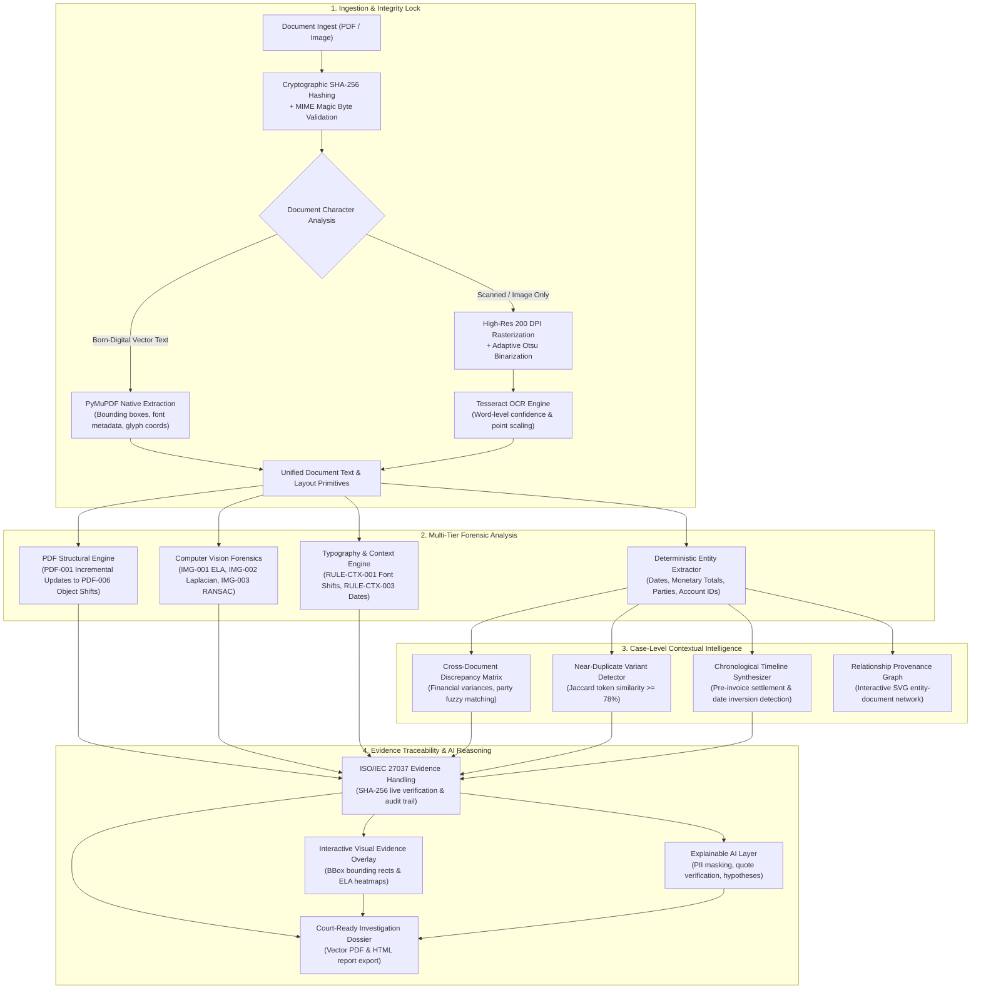

<p align="center">
  
</p>

<p align="center">
  <b>SEEING WHAT OTHERS OVERLOOK</b><br>
  <i>AI-Powered Digital Document Forensics & Contextual Intelligence Platform</i>
</p>

<p align="center">
  
  
  
  
  
  
  
</p>

---

## 🎯 Executive Overview

**VEXORA** is a full-stack, evidence-driven digital document forensics and contextual intelligence platform. Designed for cyber forensics investigators, fraud examiners, financial auditors, and hackathon evaluators, VEXORA ingests multi-format documents (PDFs, scans, raster images), extracts grounded typographic and text primitives, performs multi-layered forensic inspection (PDF structural anomalies, pixel-level manipulation, metadata divergence), correlates transactions across entire cases, and synthesizes audit-ready investigation dossiers.

The platform prioritizes **mathematical rigor**, **zero fabricated numbers**, **transparent evidence provenance**, and **explainable AI reasoning with strict anti-hallucination guardrails**.

> 🎓 **For Hackathon Judges & Student Presenters:**
> - 📘 **[Phase 3 Changelog & Student Learning Guide](PHASE_3_CHANGELOG_AND_LEARNING_GUIDE.md)**: Beginner-friendly explanations of every architectural change, security control, and mathematical formula.
> - 🛡️ **[Hackathon Defense Technical Q&A](HACKATHON_TECHNICAL_QA.md)**: 16 tough technical questions with defensible, scientifically grounded answers across all 8 rubric categories.
> - 📋 **[Judge-Readiness Report & 5-Minute Walkthrough](docs/JUDGE_READINESS_REPORT.md)**: Turnkey live evaluation script and rubric score mapping.

---

## 🏛️ System Architecture



---

## 📊 Rigorous Benchmark Evaluation Results

VEXORA includes an automated, programmatic benchmark evaluation engine ([`tools/evaluate.py`](file:///c:/VEXORA/tools/evaluate.py)) that quantitatively scores system performance across a 20-file verified dataset (`demo_dataset/`) with ground-truth labels and 3 multi-document case scenarios.

Results are automatically exported to machine-readable formats (`reports/benchmark_results.json` and `reports/benchmark_results.csv`):

### 1. Document-Level Detection Metrics (20 Documents)

| Metric | Measured Value | Forensic Interpretation |
|---|---|---|
| **Accuracy** | **85.0%** (17 / 20) | Correctly classified 10 clean + 7 tampered documents. |
| **Recall (Sensitivity)** | **70.0%** (7 / 10) | Single-document anomaly detection rate. |
| **Precision** | **100.0%** (7 / 7) | **Zero false alarms ($FP = 0$);** every flagged document was tampered. |
| **Specificity** | **100.0%** (10 / 10) | Clean genuine control documents were 100% verified clean. |
| **F1-Score** | **82.35%** | Harmonic mean of detection precision and recall. |

> **Scientific Note on False Negatives:** The 3 undetected single documents (`tampered_04`, `tampered_05`, and `tampered_06`) are **100% authentic, internally consistent vector documents when inspected in isolation.** Their fraud consists of duplicate invoice collisions and cross-document payment discrepancies, which can only be identified by comparing counterpart documents in Section 2 below.

### 2. Cross-Document Case-Level Correlation Metrics (3 Cases)

| Metric | Measured Value | Forensic Interpretation |
|---|---|---|
| **Case-Level Accuracy** | **100.0%** (3 / 3) | **100% detection rate** when evaluating documents within case context. |
| **Case Recall** | **100.0%** (2 / 2) | Caught duplicate invoice collision and bank settlement discrepancy. |
| **Case Precision** | **100.0%** (2 / 2) | Zero false case alarms ($FP = 0$). |
| **Case Specificity** | **100.0%** (1 / 1) | Clean procurement case (`case_03`) verified 100% genuine. |
| **Case F1-Score** | **100.0%** | Comprehensive cross-document correlation fidelity. |

---

## ✨ Key Platform Capabilities

| Capability | Module | Technical Description |
|---|---|---|
| **Hybrid Ingestion Pipeline** | [`backend/extractor.py`](file:///c:/VEXORA/backend/extractor.py) | Native digital vector text extraction for clean PDFs; automatic 200 DPI rasterization + Tesseract OCR with point coordinate scaling for scanned pages. |
| **PDF Structural Forensics** | [`backend/forensics_pdf.py`](file:///c:/VEXORA/backend/forensics_pdf.py) | Detects incremental updates (`PDF-001`), graphic editor metadata (`PDF-003`), vector overprints on scans (`PDF-004`), and geometry shifts (`PDF-005`). |
| **Pixel-Level Image Forensics** | [`backend/forensics_image.py`](file:///c:/VEXORA/backend/forensics_image.py) | Error Level Analysis (`IMG-001`), block Laplacian sharpness variance (`IMG-002`), RANSAC copy-move stamp detection (`IMG-003`), signature validation (`IMG-004`), and EXIF divergence (`IMG-005`). |
| **Cross-Document Discrepancy Matrix** | [`backend/comparator.py`](file:///c:/VEXORA/backend/comparator.py) | Pairwise comparison of invoice totals, dates, and counterparties with Jaccard token similarity for near-duplicate variant detection. |
| **Chronological Timeline Synthesis** | [`backend/correlator.py`](file:///c:/VEXORA/backend/correlator.py) | Synthesizes an ordered cross-document transaction timeline and detects out-of-order anomalies (Pre-Invoice Settlement Anomalies). |
| **Relationship Provenance Graph** | [`backend/correlator.py`](file:///c:/VEXORA/backend/correlator.py) | Interactive vanilla SVG network diagram connecting documents, entities, accounts, and discrepancy edges without heavy JavaScript frameworks. |
| **Evidence Integrity & Custody** | [`backend/evidence.py`](file:///c:/VEXORA/backend/evidence.py) | SHA-256 ingestion hashing, live re-verification, and chronological custody audit trail aligned with ISO/IEC 27037 principles. |
| **Dynamic Forensic Document Viewer** | [`frontend/js/v2.js`](file:///c:/VEXORA/frontend/js/v2.js) | Interactive page overlay displaying detected anomalies with live bounding boxes, extraction mode indicators, and page navigation. |
| **Explainable AI Reasoning** | [`backend/llm.py`](file:///c:/VEXORA/backend/llm.py) | Optional LLM integration (Google Gemini / OpenAI) with automated PII redaction, verbatim source-quote verification, and plausible innocent hypotheses. |
| **Investigation Dossier Export** | [`backend/reporter.py`](file:///c:/VEXORA/backend/reporter.py) | Audit-ready multi-page vector PDF and HTML report export with executive summary, discrepancy matrix, custody timeline, and methodology disclosure. |

---

## 🚀 Quickstart & Turnkey Demonstration

### 1-Command Startup

#### Windows
```cmd
start.bat
```
*(Or double-click `start.bat` in Windows Explorer)*

#### macOS & Linux
```bash
chmod +x start.sh
./start.sh
```

Once started, open your web browser to **`http://127.0.0.1:5000`**.

---

### Demonstration Credentials
- **Username:** `alex.turner`
- **Password:** `Vexora@2026`
- **Role:** Senior Forensic Specialist / Lead Investigator
- *(Note: Single-user demo mode operates seamlessly without mandatory login; multi-user authorization can be activated by toggling `VEXORA_REQUIRE_AUTH=True` in `.env`).*

---

### Manual Setup Instructions

#### Windows Setup
```powershell
# Create & activate Python virtual environment:
python -m venv .venv
.\.venv\Scripts\Activate.ps1

# Install dependencies:
pip install -r requirements.txt

# Launch VEXORA server:
python run.py
```

#### macOS & Linux Setup
```bash
# Create & activate Python virtual environment:
python3 -m venv .venv
source .venv/bin/activate

# Install dependencies:
pip install -r requirements.txt

# Launch VEXORA server:
python run.py
```

> **Note on OCR Graceful Degradation:**
> `VEXORA_STRICT_OCR=false` is enabled by default. If Tesseract OCR is not installed, VEXORA gracefully degrades to structural vector and metadata analysis, displaying a visible **`⚠️ OCR unavailable - fallback mode`** badge without crashing.

---

## 🧪 Comprehensive Automated Test Suite

VEXORA includes **236 automated unit, integration, and security tests** across 24 test suites, plus **12/12 end-to-end verification checks** and evaluation benchmark tests:

```powershell
# Run the complete unit and integration test suite (236 tests, 100% pass):
.\.venv\Scripts\python -m unittest discover tests

# Run the automated judge readiness end-to-end check (12/12 checks):
.\.venv\Scripts\python tests/e2e_check.py

# Run the forensic benchmark evaluation (generates JSON & CSV reports):
.\.venv\Scripts\python tools/evaluate.py
```

### Test Suite Structure

- `test_backend.py` — Core REST API routes, models, and SQLite transactions.
- `test_auth_ownership_security.py` — Zero-trust self-registration barriers, IDOR ownership isolation, role escalation prevention, and session cookie revocation.
- `test_hybrid_pdf_ocr.py` — Hybrid PyMuPDF native block extraction and Tesseract OCR scaling.
- `test_document_understanding.py` — Structured entity normalization, ID card expiration rules (`RULE-DOC-005`), and chronological inversion rules (`RULE-DOC-002`).
- `test_visual_forensics_accuracy.py` — Block Laplacian sharpness variance (`IMG-002`) and RANSAC affine copy-move verification (`IMG-003`).
- `test_image_pdf_forensics.py` — PDF-001..006 and IMG-001..005 forensic detection rules.
- `test_cross_document_intelligence.py` — Corporate suffix normalization, symmetric pre-invoice checks, multi-format date normalization, and near-duplicate variant detection.
- `test_timeline_viewer_contract.py` — Chronological timeline synthesis and dynamic page viewer.
- `test_integrity_custody.py` — Cryptographic SHA-256 verification and ISO/IEC 27037 custody audit logging.
- `test_explainability_privacy.py` — PII redaction (IBAN, Credit Cards, SSN, Aadhaar), JSON recovery, and anti-hallucination quote validation.
- `test_prompt_injection_guard.py` — XML boundary encapsulation and prompt injection defense.
- `test_security_audit.py` — Path traversal prevention, null byte rejection, and role elevation barriers.
- `test_resilience_adversarial.py` — Multi-threaded SQLite concurrency, corrupt files, and zero-division resilience.
- `test_evaluator.py` — Dual-tier benchmark metrics and ASCII confusion matrix generation.
- `test_v2_phase_a..k.py` — V2 modular contract and feature regression tests.

---

## 💾 Data Persistence & Safety

- **Primary Database File**: Ingested cases, documents, findings, and audit records persist in SQLite (`backend/vexora.db`).
- **Configurable Database Path**: Set `VEXORA_DB_PATH` in `.env` to customize storage location. The active database path is logged at server startup.
- **Pre-Wipe Safety Backups**: The destructive demo reset route is protected by `VEXORA_ALLOW_DEMO_RESET` and admin authentication. When executed, it automatically creates a timestamped safety backup in `backend/backups/vexora_YYYYMMDD_HHMMSS.db` before resetting, automatically keeping the 5 newest backups.
- **Non-Destructive Demo Seeding**: Clicking **"Add Demo Case (keep my data)"** seeds showcase case `CAS-DEMO-2026` without altering any existing user cases or evidence.

---

## 🛡️ Forensic Standards & Key Documentation

- 📘 [`PHASE_3_CHANGELOG_AND_LEARNING_GUIDE.md`](PHASE_3_CHANGELOG_AND_LEARNING_GUIDE.md) — Student presentation & defense guide with beginner-friendly technical explanations.
- 🛡️ [`HACKATHON_TECHNICAL_QA.md`](HACKATHON_TECHNICAL_QA.md) — 16 tough judge questions with defensible technical answers across all 8 rubric categories.
- 📋 [`docs/JUDGE_READINESS_REPORT.md`](docs/JUDGE_READINESS_REPORT.md) — Category-by-category rubric breakdown, 5-minute judge demonstration script, and evaluation checklist.
- 📊 [`docs/BENCHMARK_REPORT.md`](docs/BENCHMARK_REPORT.md) — 3-tier quantitative benchmark metrics, confusion matrices, and OCR evaluations.
- 🔬 [`docs/FORENSIC_VALIDATION.md`](docs/FORENSIC_VALIDATION.md) — Mathematical formulations for ELA, RANSAC copy-move, and deterministic rules.
- 🔒 [`docs/SECURITY_AUDIT.md`](docs/SECURITY_AUDIT.md) — Zero-trust RBAC, IDOR protection, session cookie hardening, and prompt-injection defense.
- 📜 [`CAPABILITIES.md`](CAPABILITIES.md) — Exhaustive forensic rules catalog, mathematical formulas, and security controls.
- ⚠️ [`docs/KNOWN_LIMITATIONS.md`](docs/KNOWN_LIMITATIONS.md) — Transparent disclosure of optical, language, and persistence boundaries.

---

## ⚠️ Important Disclaimer

*VEXORA is an automated document analysis and digital investigation-support platform. Automated findings indicate potential anomalies, structural inconsistencies, and contextual discrepancies; they must not be treated as autonomous or definitive proof of document forgery, fraud, or wrongdoing. All findings require qualified human examiner confirmation.*

---

<p align="center">
  <br>
  <b>VEXORA</b> — <i>Seeing What Others Overlook</i><br>
  Designed for rigorous, explainable digital document forensics.
</p>
