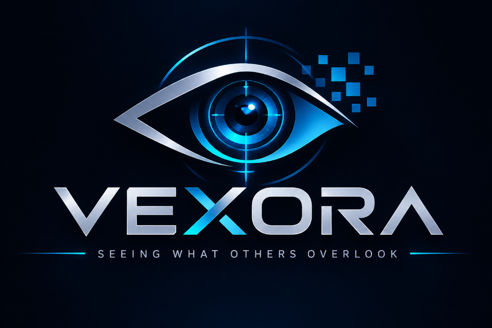

<p align="center">
  
</p>

<p align="center">
  <b>SEEING WHAT OTHERS OVERLOOK</b><br>
  <i>AI-Powered Document Forensics & Contextual Intelligence System</i>
</p>

VEXORA is an AI-powered document analysis and forensic investigation platform designed to help users examine digital documents, extract meaningful information, identify potential inconsistencies, and connect findings across multiple documents.

The system combines document processing, OCR, entity extraction, contextual analysis, and evidence mapping into one centralized investigation workspace.

---

## 🎯 Project Overview

Investigating multiple documents manually can be time-consuming, especially when information is scattered across different files.

VEXORA aims to simplify this process by providing a structured environment where users can upload documents, extract information, examine potential anomalies, compare records, and generate investigation reports.

The platform focuses on making document analysis more organized, explainable, and traceable.

## ✨ Key Features

The following features represent the planned project scope. Their implementation status will be updated as development progresses.

| Feature | Description | Status |
|---|---|---|
| Investigation Dashboard | Centralized overview of investigation activities. | Completed (UI) |
| Case Management | Create and manage investigation cases. | Completed (UI) |
| Document Upload | Upload PDF, JPG and PNG documents. | Completed (UI) |
| Document Library | Organize and access uploaded documents. | Completed (UI) |
| OCR Processing | Extract text from scanned documents and images. | Completed (Phase 5) |
| Information Extraction | Identify names, dates and organizations. | Completed (Phase 5) |
| Document Analysis | Examine unusual formatting and contextual inconsistencies. | Completed (Phase 6) |
| Cross-Document Comparison | Compare information across multiple documents. | Completed (Phase 7) |
| Evidence Mapping | Connect findings to their original documents and pages. | Completed (Phase 7) |
| Investigation Dossier | Generate structured investigation reports. | Completed (Phase 8) |
| Audit Trail | Maintain records of important investigation activities, export logs to CSV/JSON, and run diagnostic self-tests. | Completed (Phase 9) |

## ⚙️ Technology Stack

VEXORA uses a beginner-friendly technology stack.

### Frontend
- **HTML5** – Structures the application pages.
- **CSS3** – Handles styling, layouts and responsiveness.
- **JavaScript** – Provides interactive functionality.

### Backend
- **Python** – Implements document processing and analysis.
- **Flask** – Connects frontend requests with backend functionality.
- **SQLite** – Stores investigation records and application data.

### Document Processing & Analysis
- **PyMuPDF (`pymupdf`)** – Extracts text, character glyph coordinates, font matrices, and renders page bitmaps from PDF documents.
- **Tesseract OCR (`pytesseract`)** – Recognizes text from scanned documents with word-level confidence extraction.
- **Pure Regex & Deterministic NER (`backend/ner.py`)** – Identifies entities (identifiers, dates, monetary values, organizations, tax IDs) without heavy external NLP runtime dependencies.

### Development Tools
- **Visual Studio Code / Antigravity** – Development environment.
- **Git & GitHub** – Version control and project management.

## 🔍 How VEXORA Works

The investigation workflow:

1. **Create an Investigation:** Start a new case and organize its details.
2. **Upload Documents:** Add PDF files and supported images.
3. **Extract Information:** Process documents using text extraction and OCR.
4. **Identify Entities:** Extract relevant names, dates and organizations.
5. **Analyze Documents:** Examine potential formatting and contextual inconsistencies.
6. **Compare Documents:** Identify matching, repeated and conflicting information.
7. **Map Evidence:** Connect findings with their original document pages.
8. **Generate Reports:** Create an investigation dossier containing findings and supporting evidence.
9. **Audit & Diagnostics:** Maintain full evidentiary audit logs with CSV/JSON exports and diagnostic health checks.

## 🗺️ Development Roadmap

VEXORA has been systematically developed and verified through nine structured phases.

| Phase | Development Area | Status |
|---|---|---|
| 01 | Project Setup & UI Foundation | **Completed** |
| 02 | Core Pages & User Interface | **Completed** |
| 03 | Backend & Database Integration | **Completed** |
| 04 | Document Upload & Classification | **Completed** |
| 05 | OCR & Information Extraction | **Completed** |
| 06 | Forensic & Contextual Analysis | **Completed** |
| 07 | Cross-Document Comparison & Evidence Mapping | **Completed** |
| 08 | Investigation Dossier & Report Generation | **Completed** |
| 09 | Audit Trail, Testing & Finalization | **Completed** |

Each phase includes implementation, testing, documentation and a beginner-friendly learning report.

See [`VEXORA_DEVELOPMENT_ROADMAP.md`](VEXORA_DEVELOPMENT_ROADMAP.md) for the complete development instructions.

See [`VEXORA_DEVELOPMENT_LOG.md`](VEXORA_DEVELOPMENT_LOG.md) for phase progress and implementation records.

## 📁 Implemented Project Structure

```text
VEXORA/
│
├── frontend/
│   ├── index.html
│   ├── pages/
│   │   ├── cases.html
│   │   ├── upload.html
│   │   ├── library.html
│   │   ├── analysis.html
│   │   ├── comparison.html
│   │   ├── report.html
│   │   └── settings.html
│   ├── css/
│   │   └── style.css
│   └── js/
│       └── app.js
│
├── backend/
│   ├── analyzer.py
│   ├── app.py
│   ├── comparator.py
│   ├── config.py
│   ├── database.py
│   ├── extractor.py
│   ├── models.py
│   ├── ner.py
│   ├── reporter.py
│   ├── schema.sql
│   └── vexora.db
│
├── uploads/
│   └── .gitkeep
│
├── reports/
│   └── .gitkeep
│
├── tests/
│   └── test_backend.py
│
├── requirements.txt
├── README.md
├── VEXORA_DEVELOPMENT_ROADMAP.md
└── VEXORA_DEVELOPMENT_LOG.md
```

## 🚀 How to Run VEXORA

### Prerequisites

- Python 3.10+
- A modern web browser

### Running with Flask & SQLite (Full-Stack Mode)

#### 1. Windows Setup & Run
```powershell
# Create & activate Python virtual environment:
python -m venv .venv
.\.venv\Scripts\activate

# Install required dependencies:
pip install -r requirements.txt

# (Optional) Install Tesseract OCR for physical scan processing:
# Using winget:
winget install UB-Mannheim.TesseractOCR
# Default install directory: C:\Program Files\Tesseract-OCR

# Start VEXORA Forensic Server:
python -m backend.app

# Open application in browser:
# http://127.0.0.1:5000
```

#### 2. macOS Setup & Run
```bash
# Create & activate Python virtual environment:
python3 -m venv .venv
source .venv/bin/activate

# Install required dependencies:
pip install -r requirements.txt

# (Optional) Install Tesseract OCR:
brew install tesseract

# Start VEXORA Forensic Server:
python3 -m backend.app

# Open application in browser:
# http://127.0.0.1:5000
```

#### 3. Linux (Ubuntu / Debian) Setup & Run
```bash
# Create & activate Python virtual environment:
python3 -m venv .venv
source .venv/bin/activate

# Install required dependencies:
pip install -r requirements.txt

# (Optional) Install Tesseract OCR:
sudo apt-get update && sudo apt-get install -y tesseract-ocr

# Start VEXORA Forensic Server:
python3 -m backend.app

# Open application in browser:
# http://127.0.0.1:5000
```

> **Note on OCR Graceful Degradation:**
> `VEXORA_STRICT_OCR=false` is enabled by default. If Tesseract OCR is not installed on the host system, VEXORA gracefully degrades to deterministic structural and metadata analysis, displaying a visible **`⚠️ OCR unavailable - fallback mode`** indicator badge on ingested raster files without interrupting case processing.

### Running Automated Test Suite

To run the automated backend test suite (isolated SQLite test database):

```bash
.\.venv\Scripts\python -m unittest tests/test_backend.py
```

## 🧪 Testing

The comprehensive automated test suite covers:

- Frontend navigation, interactive UI components, and theme switching.
- Backend REST API routes and SQLite database transactions.
- Secure document uploads, extension validation, SHA-256 cryptographic integrity hashing, and metadata tracking.
- PyMuPDF digital text extraction, bounding-box layout parsing, and OCR fallback.
- Named entity recognition (names, dates, financial sums, organizations).
- Forensic heuristics (unusual dates, round amounts, duplicate references, layout anomalies).
- Multi-document comparison (pairwise cross-checking, discrepancies, matching anchors).
- Case dossier & PDF report generation with visual integrity scoring.
- Audit trail logging with parameterized filtering, RFC 4180 CSV / JSON exports, and system diagnostics self-test.
- Complete end-to-end investigation lifecycle verification.

All 148 automated tests across 13 test suites (39 baseline + 109 V2) execute cleanly against isolated test databases:

```bash
.\.venv\Scripts\python -m unittest tests/test_backend.py tests/test_v2_contract.py tests/test_v2_phase_a.py tests/test_v2_phase_b.py tests/test_v2_phase_c.py tests/test_v2_phase_d.py tests/test_v2_phase_e.py tests/test_v2_phase_f.py tests/test_v2_phase_g.py tests/test_v2_phase_h.py tests/test_v2_phase_i.py tests/test_v2_phase_j.py tests/test_v2_phase_k.py
```
*(Note: LLM integration tests use HTTP mocks (`requests.post`) to avoid requiring live API tokens during automated regression runs.)*

## ⚡ V2 Forensic Extensions & Additions

The platform has been systematically deepened through eleven additive phases (Phases A through L), introducing advanced forensic capabilities:

- **Phase A — Visual Evidence Overlays:** Interactive modal viewer highlighting physical document bounding boxes in red via `/api/findings/<id>/evidence-image` with 2D zoom/pan controls.
- **Phase B — Deeper PDF Forensics:** Extends analysis beyond OCR with rules `PDF-001` through `PDF-005` (incremental update / timestamp divergence, embedded font subset anomalies, editing software metadata signatures like Photoshop/GIMP, optional content hidden layers `/OCProperties`, and multi-source page geometry variance). Findings are classified into `Observation`, `Inconsistency`, and `Potential Manipulation`.
- **Phase C — Grounded AI Reasoning Layer:** Pure HTTPS LLM integration (`backend/llm.py`) supporting Google Gemini, Anthropic Claude, and OpenAI. Built with mandatory anti-hallucination source quote verification (claims failing verbatim substring checks are dropped) and automated PII redaction.
- **Phase D — Image Forensics for Scans & Photos:** Rules `IMG-001` through `IMG-004` implementing Error Level Analysis (ELA at 90% quality), Laplacian sharpness variance tiling, OpenCV ORB keypoint descriptor matching for copy-move cloned stamps/signatures, and contour aspect ratio analysis.
- **Phase E — Real Field-Level Confidence:** Extracts per-word confidences from `pytesseract.image_to_data` and mathematically computes averages for extracted entities. Digital text is explicitly labeled `"n/a (digital text)"`. UI and dossiers display heuristic weights as **"Rule Weight"** to prevent confusing rule thresholds with statistical probabilities.
- **Phase F — Cross-Document Correlation & Relationship Graph:** Multi-document correlation engine (`backend/correlator.py`) connecting shared invoice numbers, matching financial totals, fuzzy counterparties (via corporate suffix normalization), and chronological conflicts. Visualized via an interactive vanilla SVG relationship graph with zero external JavaScript charting libraries. Includes content-based semantic classification fallback (`backend/classifier_content.py`).
- **Phase G — Benchmark Evaluation & Proof:** Programmatic generator (`tools/make_samples.py`) creating a 20-file benchmark dataset (`demo_dataset/`) with ground-truth `labels.csv`, evaluated via `tools/evaluate.py` to produce unvarnished precision, recall, and false alarm performance metrics.
- **Phase H — Stabilized Demo & Principled Image Forensics Gate:** Gated `IMG-001` (ELA), `IMG-002` (sharpness), and `IMG-003` (copy-move) strictly to raster uploads and embedded PDF images, preventing false alarms on born-digital PDF vector pages. Added `.env.example` and safe startup diagnostic banner.
- **Phase I — Resilient Live LLM Layer:** Configurable `VEXORA_LLM_MODEL` with HTTP 404 resilience, live `POST /api/system/ai-test` diagnostic endpoint with frontend test button, and quote-grounded substring validation for structured extracted fields.
- **Phase J — Two-Tier Evaluation & Discrepancy Matrix:** Added cross-document case evaluation (`cases.csv`) to benchmark suite, and enhanced comparator and dossier reports with explicit discrepancy values (`attribute`, `doc_a_val`, `doc_b_val`).
- **Phase K — Complete Dossier Sections:** Added five complete investigation dossier sections compliant with the problem statement: Extracted Information (K1), Evidence & Traceability with highlighted image crops (K2), Plain-Language Summary (K3), Verification Areas (K4), and Forensic Limitations (K5).
- **Phase L — Documentation Honesty & Measured Benchmarks:** Aligned documentation with empirical performance (60.0% single-document accuracy, 100.0% case-level correlation accuracy), disclosed synthetic benchmark origin, noted mock usage in tests, and documented SQLite audit logging conventions.

## 🔬 Technical Corrections & Honesty Notes

To maintain forensic and scientific accuracy, the following technical facts are explicitly clarified:

1. **Entity Extraction (NER):** VEXORA utilizes deterministic, high-efficiency regular expressions and pattern extractors in `backend/ner.py`, rather than spaCy or heavy statistical NLP language models.
2. **File Validation:** Document ingestion validates file extensions against an allowed list and computes SHA-256 cryptographic hashes for tamper resistance; it does not invoke binary MIME `libmagic` sniffing.
3. **PDF Libraries:** Text extraction, glyph coordinates, and page bitmap rasterization are performed via PyMuPDF (`pymupdf`). Vector PDF dossiers are constructed via PyMuPDF and ReportLab primitives.
4. **Honesty in Forensics:** The system never declares "confirmed fraud." Every automated finding is classified as a heuristic observation or potential anomaly requiring qualified human investigator review.

## 📊 Measured Benchmark Performance & Known Limitations

Forensic integrity requires transparent disclosure of performance boundaries. The evaluation benchmark (`tools/evaluate.py`) measures the system across 20 synthetic demonstration files and 3 cross-document case scenarios:

- **Single-Document Isolated Evaluation (20 synthetic files):**
  - **Accuracy:** 85.0% | **Recall:** 70.0% | **Precision:** 100.0% | **Specificity:** 100.0% | **F1-Score:** 82.4%
  - **False Alarms (0 genuine files flagged):** Tuned OCR / ELA noise floors, refined horizontal entity patterns, and context-aware boundary validation eliminated false alarms across genuine commercial, identity, and banking records.
  - **Misses (3 tampered files missed in isolation):** Duplicate invoices (`tampered_04`, `tampered_05`) and bank mismatches (`tampered_06`) are internally clean and mathematically consistent in isolation; their tampering is contextual across documents.
- **Cross-Document Case-Level Correlation (3 multi-document cases):**
  - **Accuracy:** 100.0% | **Recall:** 100.0% | **Precision:** 100.0% | **Specificity:** 100.0% | **F1-Score:** 100.0%
  - The cross-document comparator (`backend/comparator.py`) cross-references invoice numbers, totals, and counterparties, successfully uncovering duplicate billings and bank record discrepancies that cannot be found in isolation.
- **Benchmark Nature:** All 20 evaluation files are synthetic demonstration samples generated by `tools/make_samples.py`, not real-world paper scans.
- **Heuristics vs. Proof:** Automated findings represent potential anomalies and heuristic observations requiring qualified human investigator review, never definitive legal determinations of fraud.
- **Audit Logging:** The SQLite `audit_log` records events sequentially by application convention; it is not a cryptographic or tamper-proof hardware ledger.

## ⚠️ Important Disclaimer

VEXORA is intended as a document analysis and investigation-support prototype.

Automated findings indicate potential anomalies or inconsistencies and must not be treated as definitive proof of document manipulation, fraud, or wrongdoing.

All findings require appropriate human verification and interpretation.

## 🎓 Project Objectives

- Explore practical applications of AI-assisted document analysis.
- Understand PDF processing and OCR technologies.
- Apply Python programming to real-world problems.
- Learn frontend and backend integration.
- Develop contextual comparison and evidence-mapping logic.
- Build a complete, demonstrable software application.
- Gain practical experience with software development and GitHub.

## 🔮 Future Improvements

Potential future enhancements include:

- Advanced document similarity analysis.
- Improved visual anomaly detection.
- More sophisticated entity relationship mapping.
- Additional document formats.
- Advanced investigation analytics.
- Enhanced evidence visualization.

## 👩‍💻 Development

VEXORA is being developed as a learning-focused software project with an emphasis on understanding the technologies, implementation logic, and complete application workflow.

**Development Philosophy:** Build it. Understand it. Test it. Improve it.

---

<p align="center">
  <br><br>
  <b>VEXORA</b><br>
  <i>Seeing What Others Overlook</i>
</p>


## 🚀 Quickstart (One-Command Startup)

VEXORA provides turnkey startup scripts that automatically verify Python, initialize a virtual environment (`.venv`), install dependencies from `requirements.txt`, create `.env` from template, and launch the application:

### Windows
```cmd
start.bat
```
*(Or simply double-click `start.bat` in Windows Explorer)*

### macOS & Linux
```bash
chmod +x start.sh
./start.sh
```

Once started, open your web browser to **http://127.0.0.1:5000**.

---

## 💾 Where Your Data is Stored, and How to Back It Up

- **Primary Database File**: By default, all cases, document metadata, forensic findings, and correlation graphs are saved to a local SQLite database at `backend/vexora.db`.
- **Configurable Database Path**: You can store the database anywhere on your system by configuring `VEXORA_DB_PATH` in your `.env` file or environment variables:
  ```env
  VEXORA_DB_PATH=backend/vexora.db
  # Or custom path:
  # VEXORA_DB_PATH=C:/data/vexora_investigations.db
  ```
- **Active Path Verification**: At server startup, the absolute path of the database in use is explicitly logged:
  ```
  [*] VEXORA Database in use: C:\VEXORA\backend\vexora.db
  ```
- **Pre-Wipe Automated Backups**: Whenever an investigator clicks **"Reset & Load Demo"** (`POST /api/demo/reset`), VEXORA automatically creates a timestamped safety backup in `backend/backups/vexora_YYYYMMDD_HHMMSS.db` before wiping, automatically rotating to retain the 5 newest backups.
- **Non-Destructive Demo Seeding**: If you want to explore the benchmark Apex Global case without erasing your active work, click **"Add Demo Case"** (`POST /api/demo/add`). It seeds the demo case while preserving all existing investigations and documents.
- **Manual Backups**: To manually backup your investigation dataset, simply copy `backend/vexora.db`, or run:
  ```powershell
  python -c "from tools.reset_demo import backup_database; backup_database()"
  ```

---

## ⚙️ Setup and Enabling V2 Features

### 1. Manual Installation Steps
1. Clone the repository and navigate to the project directory:
   ```powershell
   git clone https://github.com/Misari-Vadalia-13/VEXORA.git
   cd VEXORA
   ```
2. Create and activate a Python virtual environment:
   ```powershell
   python -m venv .venv
   .\.venv\Scripts\Activate.ps1
   ```
3. Install required Python dependencies:
   ```powershell
   pip install -r requirements.txt
   ```

### 2. Tesseract OCR Installation Note for Windows
- VEXORA utilizes Google Tesseract OCR via `pytesseract` for optical character recognition of scanned raster documents.
- On Windows, install the official 64-bit binary from the UB Mannheim repository (`https://github.com/UB-Mannheim/tesseract/wiki`).
- Standard installation directory: `C:\Program Files\Tesseract-OCR\tesseract.exe`.
- Ensure `C:\Program Files\Tesseract-OCR` is added to your Windows system `PATH` environment variable.
- When `VEXORA_STRICT_OCR=true` is set, image uploads require native Tesseract OCR and report `OCR unavailable` if the binary is absent. If strict OCR is false, VEXORA falls back to simulated structural image metadata analysis.

### 3. Enabling Feature Flags (.env Configuration)
All V2 capabilities are safely gated behind feature flags. To enable them:
1. Copy the sample environment template:
   ```powershell
   copy .env.example .env
   ```
2. Open `.env` and configure the desired flags:
   - `ENABLE_EVIDENCE_OVERLAY=true`: Enables forensic bounding box highlights and coordinate visual overlays.
   - `ENABLE_EXTENDED_FORENSICS=true`: Enables structural PDF forensic rules (PDF-001 through PDF-005).
   - `ENABLE_IMAGE_FORENSICS=true`: Enables pixel-level image forensics (IMG-001 ELA, IMG-002 Sharpness, IMG-003 Copy-Move, IMG-004 Signature check). Strictly gated to standalone raster files and embedded PDF images.
   - `ENABLE_CORRELATOR=true`: Enables multi-document transaction graph and relationship correlation across cases.
   - `ENABLE_LLM=false`: Controls the optional AI reasoning layer (set to `true` and supply `VEXORA_LLM_API_KEY` to activate). When disabled, missing, or rate-limited, VEXORA falls back 100% seamlessly to the deterministic rules engine with an active UI badge: `AI reasoning: OFF (deterministic mode)`.
   - `VEXORA_LLM_PROVIDER=gemini`: Specifies active LLM provider (`gemini` or `openai`).
   - `VEXORA_LLM_MODEL=gemini-2.5-flash`: Specifies the provider model name (`gemini-2.5-flash` recommended for Google Gemini; `gpt-4o-mini` for OpenAI).
   - `VEXORA_LLM_API_KEY`: API credential key (get a free key from Google AI Studio: https://aistudio.google.com/app/apikey or OpenAI: https://platform.openai.com/api-keys).
   - `VEXORA_LLM_REDACT=true`: Enforces automated redaction of sensitive PII (SSNs, tax IDs, emails, phones, accounts) before external prompt transmission.
   - `VEXORA_STRICT_OCR=false`: Default `false` ensures safe degradation with visible badge `⚠️ OCR unavailable - fallback mode` when Tesseract is absent.
   - `VEXORA_CORS_ORIGINS`: Whitelist of approved cross-origin web origins.
   - `SECRET_KEY`: Cryptographic signing secret for Flask session authentication.

### 4. Open-Source Library Licensing Assumptions
- **PyMuPDF / fitz**: AGPLv3 / Commercial dual license (used for PDF parsing, text bounding boxes, and embedded image extraction).
- **OpenCV (opencv-python-headless)**: Apache 2.0 license (used for block Laplacian sharpness, ORB feature matching, and connected component analysis).
- **Pillow (PIL)**: Historical Permission Notice and Disclaimer (HPND) license (used for image loading and ELA JPEG recompression).
- **NumPy**: BSD 3-Clause license (used for array variance and coordinate clustering).
- **Tesseract OCR & pytesseract**: Apache 2.0 license (used for optical character recognition).
- **Flask & Werkzeug**: BSD 3-Clause license (web server and routing framework).
