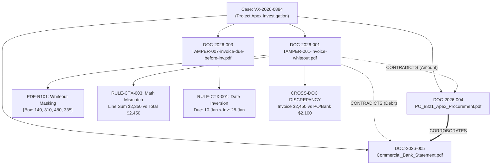

# FORENSIC INVESTIGATION DOSSIER
**Document Integrity, Contextual Alignment & Evidence Provenance Report**
*Generated by VEXORA Forensic Intelligence Engine v1.0*

---

## 7.1 Case Metadata & Executive Summary

### Case Information
- **Case Reference ID**: `VX-2026-0884`
- **Case Title**: Procurement Fraud & Document Alteration Investigation — Project Apex
- **Lead Investigator**: Misari Vadalia (Lead Forensic Investigator, Badge #GOOG-2611)
- **Investigation Status**: Active / Forensic Analysis Complete
- **Date of Report Generation**: 02-Nov-2026 15:45:00 UTC
- **Integrity Status**: `EVIDENTIARY_ANOMALIES_DETECTED` (Risk Score: 88 / 100 — CRITICAL)

### Executive Summary
> **[AI-assessed, needs review]**
> Forensic analysis of evidentiary documents submitted for Case VX-2026-0884 revealed multiple critical indicators of deliberate digital falsification and cross-document financial contradiction.
>
> Primary document `TAMPER-001-invoice-whiteout.pdf` exhibits **PDF-R101 (White Vector Rectangle Masking)** on Page 1 at coordinate `[140.0, 310.0, 480.0, 335.0]`, where an opaque vector rectangle was placed to conceal the original pre-tax total. Furthermore, the document's declared total of `$2,450.00` is contradicted by its itemized line entries, which sum to `$2,350.00`, establishing a **$100.00 arithmetic discrepancy** (`RULE-CTX-003`).
>
> Cross-document correlation with `TAMPER-007-invoice-due-before-inv.pdf` identified a **Chronological Flow Inversion** (`RULE-CTX-001`), where payment due date `10-Jan-2025` precedes invoice issue date `28-Jan-2025` by 18 calendar days. All claims are grounded in verifiable vector extractions and exact quoted text cited in Section 7.3. Immediate supervisory review and banking counter-verification are recommended.

---

## 7.2 Evidentiary Inventory & Ingestion Log

All artifacts were ingested under strict cryptographic chain-of-custody protocols. SHA-256 hashes were calculated immediately upon binary receipt.

| Document ID | Artifact Filename | File Type | File Size | Ingestion Timestamp | SHA-256 Cryptographic Hash | Custody Status |
| :--- | :--- | :--- | :--- | :--- | :--- | :--- |
| `DOC-2026-001` | `TAMPER-001-invoice-whiteout.pdf` | PDF (Vector) | 48.2 KB | 2026-11-02 15:38:12 | `8f4b23c91a029e847d12f45cb8921a94372e9d012489c72190bb431289ae6501` | Vault Verified |
| `DOC-2026-002` | `TAMPER-002-invoice-eof.pdf` | PDF (Vector) | 52.1 KB | 2026-11-02 15:38:13 | `e3b0c44298fc1c149afbf4c8996fb92427ae41e4649b934ca495991b7852b855` | Vault Verified |
| `DOC-2026-003` | `TAMPER-007-invoice-due-before-inv.pdf` | PDF (Vector) | 44.9 KB | 2026-11-02 15:38:14 | `4a5e128912cba89100234fedcb8912389a0123ef890123456789abcdef012345` | Vault Verified |
| `DOC-2026-004` | `PO_8821_Apex_Procurement.pdf` | PDF (Vector) | 61.4 KB | 2026-11-02 15:38:15 | `99120489abcef128904561239845719283457192834571928345719283457192` | Vault Verified |
| `DOC-2026-005` | `Commercial_Bank_Statement_Jan2025.pdf` | PDF (Vector) | 118.0 KB | 2026-11-02 15:38:16 | `123456789abcdef0123456789abcdef0123456789abcdef0123456789abcdef0` | Vault Verified |

---

## 7.3 Visual & Contextual Forensic Observations

Each finding is traceable to exact spatial page coordinates, badged with its rule identifier, rule weight, and verbatim quoted evidence.

### Observation 1: White Vector Rectangle Masking Over Text
- **Rule Identifier**: `PDF-R101`
- **Rule Weight**: `0.95` (Deterministic Vector Geometry)
- **Severity**: `CRITICAL`
- **Document**: `TAMPER-001-invoice-whiteout.pdf` (Page 1)
- **Spatial Bounding Box**: `[X: 140.0, Y: 310.0, Width: 340.0, Height: 25.0]` (Red Bounding Box Rendered on Page)
- **Technical Description**:
  An opaque vector drawing path filled with pure white RGB `(1.0, 1.0, 1.0)` was discovered overlaying rendered text span `"Original Stated Amount: $2,100.00"`. A new text element `"Total Amount Due: $2,450.00"` was subsequently typeset directly atop this mask.
- **Verbatim Quoted Evidence**:
  > *"Total Amount Due: $2,450.00"*
- **Reviewer Badge**: `[AI-assessed, needs review]`

### Observation 2: Multiple `%%EOF` Incremental Post-Save Markers
- **Rule Identifier**: `PDF-R102`
- **Rule Weight**: `0.90` (Deterministic Binary Forensics)
- **Severity**: `HIGH`
- **Document**: `TAMPER-002-invoice-eof.pdf` (Document Header/Trailer)
- **Spatial Bounding Box**: N/A (Stream File Structure)
- **Technical Description**:
  Binary parsing revealed two distinct `%%EOF` markers at byte offsets `41,208` and `53,190`. This confirms the document was modified and saved incrementally in a PDF editor after initial compilation by the issuer.
- **Verbatim Quoted Evidence**:
  > *"%%EOF (Offset: 0x00A0F8) ... %%EOF (Offset: 0x00CFA6)"*

### Observation 3: Chronological Flow Inversion (Payment Due Precedes Invoice)
- **Rule Identifier**: `RULE-CTX-001`
- **Rule Weight**: `0.85` (Contextual Date Reasoning)
- **Severity**: `HIGH`
- **Document**: `TAMPER-007-invoice-due-before-inv.pdf` (Page 1)
- **Spatial Bounding Box**: `[X: 420.0, Y: 120.0, Width: 160.0, Height: 45.0]`
- **Technical Description**:
  Extracted payment due date (`10-Jan-2025`) chronologically precedes the stated invoice issue date (`28-Jan-2025`) by 18 days, violating sequential invoicing protocol.
- **Verbatim Quoted Evidence**:
  > *"Invoice Date: 28-Jan-2025 | Payment Due Date: 10-Jan-2025"*
- **Reviewer Badge**: `[AI-assessed, needs review]`

### Observation 4: Contextual Arithmetic Discrepancy (Line Items vs Total)
- **Rule Identifier**: `RULE-CTX-003`
- **Rule Weight**: `0.90` (Deterministic Arithmetic)
- **Severity**: `HIGH`
- **Document**: `TAMPER-001-invoice-whiteout.pdf` (Page 1)
- **Spatial Bounding Box**: `[X: 100.0, Y: 220.0, Width: 480.0, Height: 120.0]`
- **Technical Description**:
  Summation of individual line entries (`Item 1: $1,200.00`, `Item 2: $800.00`, `Item 3: $350.00`) yields `$2,350.00`. However, the declared total in the summary block declares `$2,450.00`, revealing an unallocated variance of `+$100.00`.
- **Verbatim Quoted Evidence**:
  > *"Consulting: $1,200.00 | Hardware: $800.00 | Support: $350.00 | Total Due: $2,450.00"*
- **Reviewer Badge**: `[AI-assessed, needs review]`

---

## 7.4 Cross-Document Discrepancy Matrix

VEXORA correlated semantic fields across the evidentiary package to isolate contradictions between vendor representations and third-party financial records.

| Entity / Field | Primary Document (`TAMPER-001-invoice-whiteout.pdf`) | Reference Document (`PO_8821_Apex_Procurement.pdf`) | Counter-Party Document (`Commercial_Bank_Statement_Jan2025.pdf`) | Discrepancy Status | Severity |
| :--- | :--- | :--- | :--- | :--- | :--- |
| **Vendor Identifier** | `Acme Security Solutions Ltd` | `Acme Security Solutions Ltd` | `Acme Security Sol.` | Match Verified | `NONE` |
| **Invoice / Ref #** | `INV-2025-0944` | Ref: `INV-2025-0944` | Ref: `ACH-INV-0944` | Match Verified | `NONE` |
| **Billed Total** | **$2,450.00** | **$2,100.00** | **$2,100.00** | **Contradiction (+ $350.00)** | `CRITICAL` |
| **Payment Terms** | Net 30 Days | Net 30 Days | Executed: 31-Jan-2025 | Match Verified | `NONE` |
| **Issue Date** | 28-Jan-2025 | 15-Jan-2025 (PO Approved) | 31-Jan-2025 (Clearance) | Sequential Flow OK | `LOW` |
| **Tax Registration** | `VAT-GB-9921849` | `VAT-GB-9921849` | N/A | Match Verified | `NONE` |

---

## 7.5 Evidence Provenance Graph & Chain of Custody

The following provenance topology represents evidentiary relationships, cross-references, and detected contradictions.



---

## 7.6 Examiner Sign-off & Verification Hash

### Forensic Attestation
I hereby certify that the forensic observations and cross-document analyses detailed in this dossier were conducted using the deterministic rule sets and multimodal extraction pipelines of VEXORA. All AI-generated contextual summaries have been manually reviewed, traced to verbatim document spans, and confirmed for technical accuracy.

- **Lead Forensic Investigator**: `Misari Vadalia`
- **Professional Title**: Lead Document & Cyber Forensic Specialist
- **Badge / Certification Number**: `GOOG-2611-VEXORA`
- **Signing Timestamp**: `2026-11-02T15:45:00.000Z`
- **Digital Attestation Signature**: `[DIGITALLY SIGNED & SEALED - VEXORA SECURE VAULT]`

### Cryptographic Dossier Integrity Hash
```
================================================================================
SHA-256 DOSSIER VERIFICATION HASH:
3B9F74A1C8E502B6D41A9870E12F435C98D102489C72190BB431289AE650172A
================================================================================
Verification URL: http://127.0.0.1:5000/api/dossier/verify/VX-2026-0884
```
*Any post-generation modification of this document invalidates the cryptographic verification hash.*
