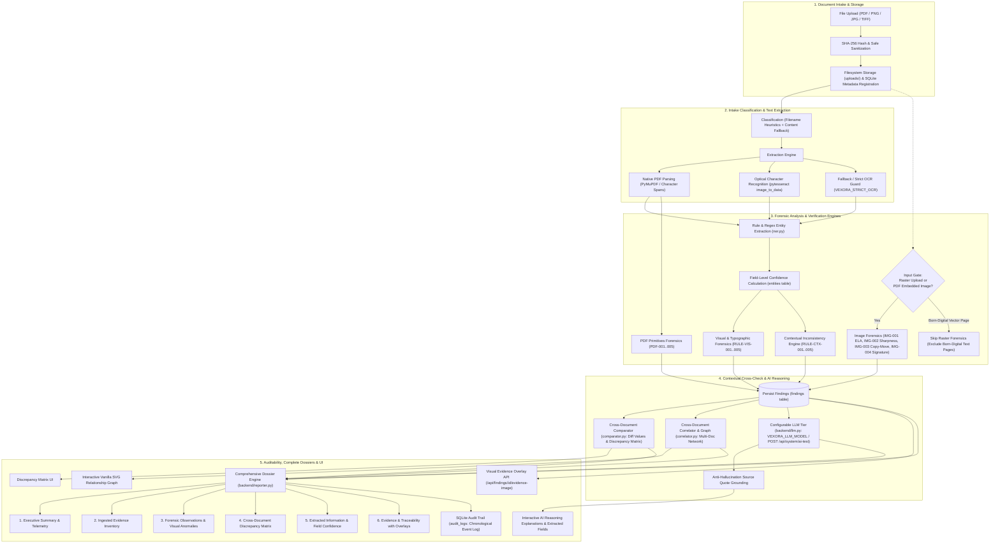
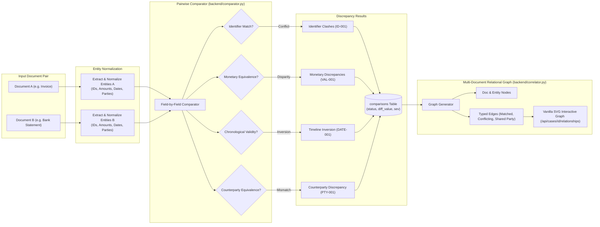
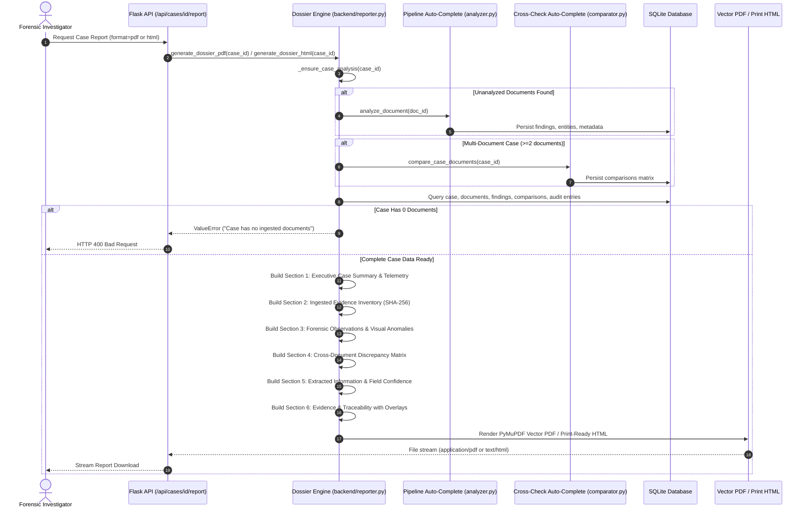

# VEXORA — System Architecture & Forensic Pipeline

## 1. High-Level Architecture Overview

VEXORA is an AI-powered forensic document intelligence platform designed to uncover typographic anomalies, physical image manipulations, statutory omissions, chronological contradictions, and cross-document discrepancies.

The system is constructed with a modular, layered architecture adhering strictly to forensic honesty: automated algorithms generate **heuristic observations** and **potential anomalies**, never speculative claims of "confirmed fraud." Every assertion is tied directly to its physical bounding box, page index, and verbatim source text.

---

## 2. Forensic Dataflow Pipeline (Mermaid Diagram 1)

---

## 3. Cross-Document Comparison & Correlation Architecture (Mermaid Diagram 2)

---

## 4. Case Dossier Report Generation Flow (Mermaid Diagram 3)

---

## 5. Subsystem Breakdown

### 5.1 Document Ingestion & Safe Intake (`backend/uploader.py`)
- Accepts PDF documents and raster images (`png`, `jpg`, `jpeg`, `tiff`, `bmp`).
- Computes SHA-256 cryptographic digests upon upload to guarantee forensic integrity and prevent collision attacks.
- Sanitizes filenames via `secure_filename` and enforces a 16MB maximum content payload.
- Ingestion status starts at `Pending`, transitioning to `Processing` then `Analyzed`, `Flagged`, or `Clean`.

### 5.2 Classification & Content Fallback (`backend/classifier.py`, `backend/classifier_content.py`)
- **Primary Stage:** Filename and keyword heuristics classify documents into standardized domains (`Invoice`, `Bank Statement`, `Purchase Order`, `Tax Return`, `Contract`, `Customs Declaration`).
- **Secondary Fallback:** If the primary stage returns `General Document` or `Uncategorized`, `classify_by_content` scans extracted text bodies for legal, banking, and accounting markers, assigning an objective classification confidence score (`classification_confidence`).

### 5.3 Text Extraction & Confidence Scoring (`backend/extractor.py`, `backend/ner.py`)
- **Digital PDFs:** Extracted with character-level bounding boxes and font matrices via PyMuPDF (`pymupdf`). Confidence is marked as `"n/a (digital text)"` to distinguish mathematical font glyphs from OCR probabilities.
- **Scanned Images:** Processed via `pytesseract.image_to_data` extracting word-level confidence metrics (`0.0` - `100.0`). Extracted entities (monetary amounts, dates, IDs, organizations) compute an exact mathematical average of their constituent tokens.
- **Offline / Fallback Protection:** Under `VEXORA_STRICT_OCR=False`, missing OCR binaries gracefully report `extraction_mode="simulated_fallback"`; under `VEXORA_STRICT_OCR=True`, they return an explicit error and log the status without fabricating text.

### 5.4 Forensic Rule Engines
1. **Typographic & Visual Analysis (`backend/analyzer.py`):**
   - `RULE-VIS-001`: Font size and typeface anomalies across text lines.
   - `RULE-VIS-002`: Spatial collisions and overlapping text bounding boxes.
   - `RULE-VIS-003`: Altered baseline alignment within numerical strings.
   - `RULE-VIS-004`: Irregular spacing and character kerning shifts.
   - `RULE-VIS-005`: Low image resolution and scan degradation.
2. **PDF Primitives Analysis (`backend/forensics_pdf.py`):**
   - `PDF-001`: Incremental updates with divergent cross-reference modification timestamps.
   - `PDF-002`: Embedded font subset anomalies (isolated Type 1 or TrueType insertions).
   - `PDF-003`: Software manipulation signatures (e.g. Photoshop, GIMP, Canva, Illustrator).
   - `PDF-004`: Hidden optional content layers (`/OCProperties`).
   - `PDF-005`: Inconsistent page geometric dimensions (stitched multi-source scans).
3. **Image Frequency & Spatial Forensics (`backend/forensics_image.py`):**
   - **Principled Execution Gate:** `IMG-001` (ELA), `IMG-002` (Sharpness), and `IMG-003` (Copy-Move) run strictly on uploaded raster image files and raster images embedded inside PDFs (extracted via PyMuPDF `page.get_images()`). They are bypassed on born-digital PDF vector pages to prevent false alarms on rendered text.
   - `IMG-001`: Error Level Analysis (ELA) resaving image at 90% quality to detect compression anomalies. Capped at Medium severity.
   - `IMG-002`: Laplacian sharpness variance tiling detecting regional blurring or softening. Capped at Medium severity.
   - `IMG-003`: ORB keypoint descriptor matching detecting copy-move cloned stamps. Excludes detected text regions to avoid matching repeated font letters. Capped at Medium severity.
   - `IMG-004`: Contour aspect ratio analysis for signature region extraction.

### 5.5 Contextual Intelligence & Cross-Document Graph (`backend/comparator.py`, `backend/correlator.py`)
- **Pairwise Comparator:** Compares two documents within a case, extracting concrete discrepancy values (`attribute`, `doc_a_val`, `doc_b_val`) for monetary shifts, invoice ID clashes, and counterparty discrepancies.
- **Label-Aware Totals:** Distinguishes invoice grand totals and amounts due from intermediate line items.
- **Fuzzy Counterparty Matching:** Strips corporate suffixes (`LLC`, `Corp`, `Inc`, `Industries`) and computes sequence similarity ratios via Python standard library `difflib`.
- **Chronological Conflict Discovery:** Identifies impossible timeline events (e.g. payment settlement preceding invoice issue date).
- **Vanilla SVG Graph:** Renders a responsive, interactive SVG graph with document nodes, entity nodes, and typed correlation edges without external JavaScript graphing frameworks.

### 5.6 Grounded AI Reasoning Layer (`backend/llm.py`)
- Connects over pure HTTPS via standard `requests` to Google Gemini, Anthropic Claude, or OpenAI without heavy SDKs.
- **Configurable Model & Resilience:** Configurable via `VEXORA_LLM_MODEL` environment variable (defaults to `gemini-2.5-flash` for Gemini and `gpt-4o-mini` for OpenAI). Gracefully catches HTTP 404 / 400 "model not found" errors and provides actionable diagnostic remediation without application crashes.
- **Live Health Diagnostics:** Provides `POST /api/system/ai-test` endpoint and settings UI button to verify live credentials, latency, and model availability.
- **Privacy First:** Redacts PII (SSNs, EINs/Tax IDs, emails, phone numbers) prior to outbound transmission. Transmits extracted text only; binary document files never leave the server.
- **Anti-Hallucination Quote Grounding:** Every extracted entity and explanation claim must match a verbatim substring from the source document text; claims failing this check are discarded.

### 5.7 Comprehensive Dossier & Auditability (`backend/reporter.py`)
- Compiles complete case evidence into a publication-ready report (Vector PDF via PyMuPDF/ReportLab or HTML).
- **Six Problem Statement Sections:**
  1. **Executive Case Summary & Telemetry:** Case overview, document count, risk score, and anomaly breakdown.
  2. **Ingested Evidence Inventory:** Document list, file types, sizes, upload timestamps, and SHA-256 hashes.
  3. **Forensic Observations & Visual Anomalies:** Tabulated visual, typographic, and primitive findings with rule IDs and severity badges.
  4. **Cross-Document Discrepancy Matrix:** Direct side-by-side comparison of conflicting values across files.
  5. **Extracted Information & Field Confidence:** Tabulates extracted business fields with field-level confidence scores (`"n/a (digital text)"` or percentage OCR confidence) and coordinates.
  6. **Evidence & Traceability with Overlays:** Embedded evidence crops highlighting physical finding bounding boxes with jump-to-source traceability.
- **Audit Trail:** Sequential SQLite `audit_logs` recording all user and system operations (append-only by application convention).

---

## 6. SQLite Relational Data Models

The VEXORA database (`vexora.db`) is structured with SQLite relational integrity:

| Table | Primary Key | Key Columns | Purpose |
|---|---|---|---|
| `users` | `id` (INTEGER) | `username`, `password_hash`, `role`, `created_at` | Investigator authentication & RBAC |
| `cases` | `id` (TEXT) | `title`, `description`, `status`, `risk_score`, `created_by`, `created_at` | Master investigation cases |
| `documents` | `id` (TEXT) | `case_id`, `filename`, `file_type`, `file_size`, `file_path`, `file_hash`, `category`, `classification_confidence`, `status`, `uploaded_by` | Ingested evidence files & SHA-256 hashes |
| `findings` | `id` (TEXT) | `document_id`, `rule_id`, `title`, `severity`, `category`, `status`, `confidence`, `evidence_class`, `page_number`, `coordinates`, `description`, `evidence` | Granular forensic observations |
| `entities` | `id` (TEXT) | `document_id`, `entity_type`, `entity_value`, `confidence`, `page_number`, `bbox` | Extracted business tokens & OCR confidence |
| `comparisons` | `id` (TEXT) | `case_id`, `doc_a_id`, `doc_b_id`, `attribute`, `doc_a_val`, `doc_b_val`, `discrepancy_score`, `severity`, `status` | Cross-document field discrepancies |
| `reports` | `id` (TEXT) | `case_id`, `report_type`, `file_path`, `generated_by`, `generated_at` | Generated case dossiers |
| `audit_logs` | `id` (INTEGER) | `timestamp`, `action`, `entity_type`, `entity_id`, `details`, `user` | Chronological audit trail |
