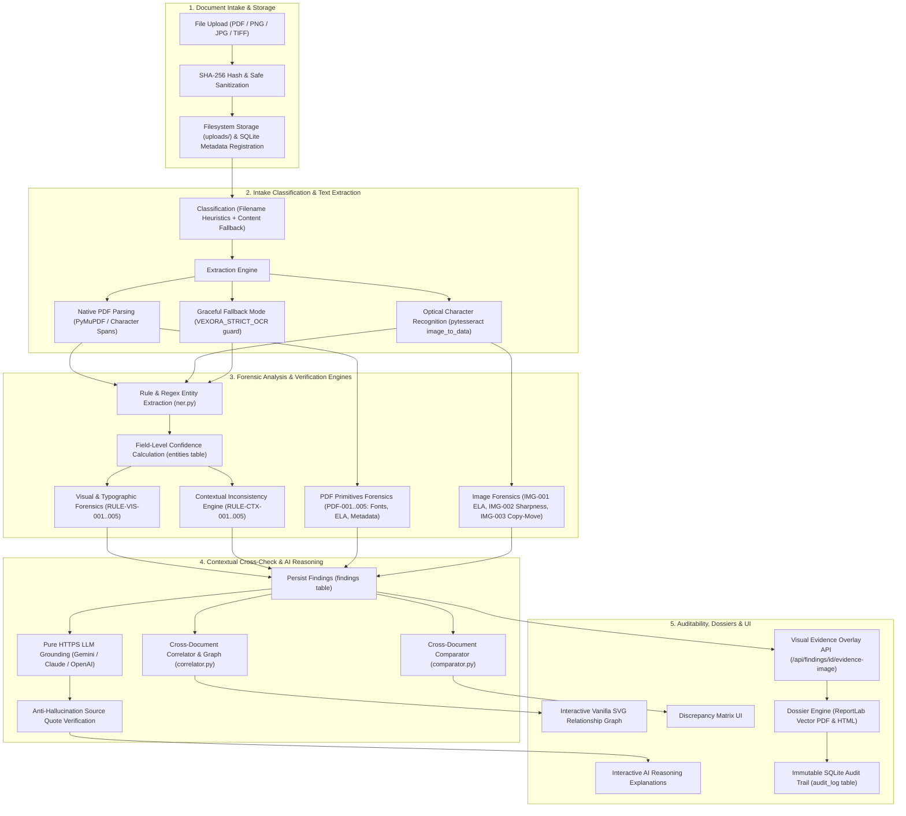

# VEXORA — System Architecture & Forensic Pipeline

## 1. High-Level Architecture Overview

VEXORA is an AI-powered forensic document intelligence platform designed to uncover typographic anomalies, physical image manipulations, statutory omissions, chronological contradictions, and cross-document discrepancies.

The system is constructed with a modular, layered architecture adhering strictly to forensic honesty: automated algorithms generate **heuristic observations** and **potential anomalies**, never speculative claims of "confirmed fraud." Every assertion is tied directly to its physical bounding box, page index, and verbatim source text.

---

## 2. Forensic Dataflow Pipeline (Mermaid Diagram)

---

## 3. Subsystem Breakdown

### 3.1 Document Ingestion & Safe Intake (`backend/uploader.py`)
- Accepts PDF documents and raster images (`png`, `jpg`, `jpeg`, `tiff`, `bmp`).
- Computes SHA-256 cryptographic digests upon upload to prevent duplicate collision attacks.
- Sanitizes filenames via `secure_filename` and enforces a 16MB maximum content payload.

### 3.2 Classification & Content Fallback (`backend/classifier.py`, `backend/classifier_content.py`)
- **Primary Stage:** Filename and keyword heuristics classify documents into standardized domains (`Invoice`, `Bank Statement`, `Purchase Order`, `Tax Return`, `Contract`, `Customs Declaration`).
- **Secondary Fallback:** If the primary stage returns `General Document` or `Uncategorized`, `classify_by_content` scans extracted text bodies for legal, banking, and accounting markers, refining the category without overriding filename rules.

### 3.3 Text Extraction & Confidence Scoring (`backend/extractor.py`, `backend/ner.py`)
- **Digital PDFs:** Extracted with character-level bounding boxes and font matrices via PyMuPDF (`pymupdf`). Confidence is marked as `"n/a (digital text)"` to distinguish mathematical font glyphs from OCR probabilities.
- **Scanned Images:** Processed via `pytesseract.image_to_data` extracting word-level confidence metrics (`0.0` - `100.0`). Extracted entities (monetary amounts, dates, IDs, organizations) compute an exact mathematical average of their constituent tokens.
- **Offline / Fallback Protection:** Under `VEXORA_STRICT_OCR=False`, missing OCR binaries gracefully report `extraction_mode="simulated_fallback"`; under `VEXORA_STRICT_OCR=True`, they return an explicit error and log the status without fabricating text.

### 3.4 Forensic Rule Engines
1. **Typographic & Visual Analysis (`backend/analyzer.py`):**
   - `RULE-VIS-001`: Font size and typeface anomalies across text lines.
   - `RULE-VIS-002`: Spatial collisions and overlapping text bounding boxes.
   - `RULE-VIS-003`: Altered baseline alignment within numerical strings.
   - `RULE-VIS-004`: Irregular spacing and character kerning shifts.
   - `RULE-VIS-005`: Low image resolution and scan degradation.
2. **PDF Primitives Analysis (`backend/forensics_pdf.py`):**
   - `PDF-001`: Incremental updates with divergent cross-reference modification timestamps.
   - `PDF-002`: Embedded font subset anomalies (isolated Type 1 or TrueType insertions).
   - `PDF-003`: Software manipulation signatures (e.g. Photoshop, GIMP, Canva, Illustrator).
   - `PDF-004`: Hidden optional content layers (`/OCProperties`).
   - `PDF-005`: Inconsistent page geometric dimensions (stitched multi-source scans).
3. **Image Frequency & Spatial Forensics (`backend/forensics_image.py`):**
   - `IMG-001`: Error Level Analysis (ELA) resaving image at 90% quality to detect compression anomalies.
   - `IMG-002`: Laplacian sharpness variance tiling detecting regional blurring or softening.
   - `IMG-003`: ORB keypoint descriptor matching detecting copy-move stamp and signature cloning.
   - `IMG-004`: Contour aspect ratio analysis for signature extraction.

### 3.5 Contextual Intelligence & Cross-Document Graph (`backend/correlator.py`)
- **Label-Aware Totals:** Distinguishes invoice grand totals and amounts due from intermediate line items.
- **Fuzzy Counterparty Matching:** Strips corporate suffixes (`LLC`, `Corp`, `Inc`, `Industries`) and computes sequence similarity ratios via Python standard library `difflib`.
- **Chronological Conflict Discovery:** Identifies impossible timeline events (e.g. payment settlement preceding invoice issue date).
- **Vanilla SVG Graph:** Renders a responsive, interactive SVG graph with document nodes, entity nodes, and typed correlation edges without external JavaScript graphing frameworks.

### 3.6 Grounded AI Reasoning Layer (`backend/llm.py`)
- Connects over pure HTTPS via `requests` to Google Gemini, Anthropic Claude, or OpenAI.
- **Privacy First:** Redacts PII (emails, phone numbers, long digit sequences) prior to outbound transmission. Transmits extracted text only; binary document files never leave the server.
- **Anti-Hallucination Quote Grounding:** Every extracted entity and explanation claim must match a verbatim substring from the source document text; claims failing this check are discarded.

### 3.7 Traceability & Investigation Dossier (`backend/reporter.py`)
- Compiles complete case evidence into a publication-ready report (Vector PDF via PyMuPDF/ReportLab or HTML).
- Mandatory legal disclaimer: automated findings represent forensic observations, not legal adjudications.
- Complete SQLite audit trail recording all user and system operations.
